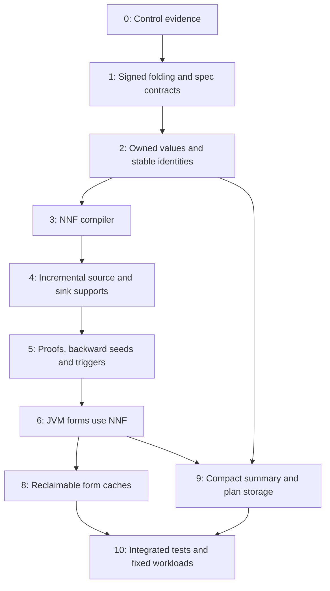

# Implementation plan: O1, O2 and O3

Status: historical implementation plan, corrected for the requested rollback. Updated: 13 October 2026.
The selected O1–O3 work remains, but the manager rewrite and weak identity cache are removed. Existing
test/project measurements precede that rollback; revised-code validation is recorded separately in the
[implementation record](../reports/bidirectional-o1-o3-implementation.md). Use the
[new optimization proposal](bidirectional-core-optimization-20261013.md) for future priorities.

Deliver small commits with a parent revision, focused tests and a stated acceptance result. Keep the IR, other optimization families and project settings outside these commits. The expected memory-impact order is O1, O2, O3; the first steps establish the ownership and identity that they need.

## Dependency order



Step 7's manager rewrite is rolled back. Step 8 uses the original managed-reference API. The managed cache
requires stable logical identities and passing forced-rebuild controls. Step 9 can be split into early
empty/singleton changes and final indexes. Keep cache policy, condition semantics and collection changes separate.

## 0. Record the control and acceptance fixtures

Create a new evidence directory for this implementation series. Record the exact branch revision and working patch hash. Preserve the existing workspace changes and reports. Use the [input inventory](../reports/bidirectional-project-inputs.md) and [project report](../reports/bidirectional-project-testing.md) as the fixed workload/control inventory.

Record the current common/JVM bidi test results and the known broader query-suite failures. Build small source/sink fixtures for cross-base AND, nested OR/AND, repeated leaves, array arguments, static requests, end facts and normal/exceptional exits. Include the signed contradiction policy in the expected semantics.

Add a test-only cube oracle and an independent small support-binding evaluator. The oracle first uses the corrected signed folder, then performs the existing positive approximation and expansion. Limit expansion only in the test fixture generator, whose inputs are deliberately small; production has no such cap.

Add opt-in counters for expression/form sizes, actual support/proof counts, managed cache access/rebuilds and container/index sizes. Keep normal scans free of per-event logging. Counters must distinguish compiled potential structure from runtime supported outcomes.

**Exit gate:** a control manifest, known-failure record and small semantic fixture inventory exist. No benchmark input or run limit has changed.

## 1. Define the corrected signed policy and specification changes

Update the condition and implementation contracts in `spec/interpreter.md`, `spec/ap.md`, `spec/ap-impl.md`, `spec/analyzer-core.md`, `spec/analyzer-impl.md` and `spec/validation-plan.md`. State the new signed-fold order, structural proof handles, stable identity across rebuilds, footprint behavior and application-scoped pins. Keep the exclusion table and prior validation case IDs.

Add an iterative signed folder in common condition code, called by the bidi rule compiler before static rewriting and again afterward. Preserve negative literal information through these folds. Reuse existing static atom evaluation for surviving nodes. Fold constants, duplicate operands and direct complements; use non-distributing unit propagation to prove false/true scopes after array specialization. Retain live requirement/read structure when no such proof exists. Do not use guessed assignments, distribution or a SAT solver, and do not silently change unrelated engine callers of common helpers.

Wire the folder into source/sink compilation and the source rewriter's false-condition check. Preserve raw validation before folding. Keep current cleaner action normalization and remaining cleaner/pass policy.

Tests must establish:

- `P AND NOT P` is false for both source and sink rules.
- A real serialized Object/array argument rule expands to `(P0 OR P1) AND NOT P0 AND NOT P1` and still folds false.
- A raw `TypeMatchesPattern(P,T) AND NOT TypeMatchesPattern(P,T)` folds false before the polarity-sensitive static evaluator can erase the complement; include a Parent-typed argument with a Child pattern.
- `P OR NOT P` is true; `A OR (P AND NOT P)` keeps only `A`.
- Distinct positions, marks and root/any-field atoms are not treated as complements.
- Invalid positions/actions in a discarded branch still reject the raw rule.
- A false rule has no request, exit footprint, action, seed or trigger.
- Residual negative source/sink literals retain the approximation only after signed folding; cleaner/pass controls still pass.

**Exit gate:** these cases pass. Any difference from the old contradiction behavior has an explicit normalization explanation, rather than a weakened comparison assertion.

## 2. Add ownership factories and stable logical keys

Introduce internal empty/singleton/owned-array vectors and read-only factories needed by the predicate compiler. Public construction makes one defensive copy. A trusted internal factory adopts only newly owned arrays. Keep this part small; final set/map/index work is step 9.

Add `FormKey`, `RuleOccurrenceId`, `ActionId`, canonical `LeafKey`, observed `ProofKey` and deterministic generated `TemporaryKey`. Bind provider rule tokens to original occurrences and method specialization, not only the displayed or serialized rule ID. Include application role/stage and generated relevant-mark/string-byte/field-step ordinals in action and temporary keys. Ensure source order determines ordinals. Cache allocation epochs, run index, field limit and direction are excluded from occurrence equality.

Change rule join keys, trigger-once keys and `Guard.SinkTriggered` comparisons to logical IDs while the legacy cube evaluator still runs. Preserve E6's existing callee/premise/layer/call key. Retain owned source-edge value descriptors and report metadata without a form-owner backreference.

Add generated keyed construction for `AccessPathBase.CleanerTemporary`, while preserving unique fresh manual construction. Reverse field actions share their action's key; separate actions never share one merely because their tuples are equal. Keep temporary escape checks.

Targets include `ConjunctionStore`, `RunMethodLocalServices`, `RunMethodCallServices`, `RuleStatement`, `CallPlan`, `HandOff`, `Seeds`, `SourceHitStore`, `VulnerabilityStore` and `Accessors.kt`. Do not create a strong registry of every wrapper or potential proof.

**Exit gate:** the legacy engine still passes its semantic fixtures after logical-key migration; equal-content distinct rule occurrences remain separate; generated identities are stable across two independent rebuilds; public input mutation and temporary boundary tests pass. Compile the Go and other common API consumers affected by new constructors.

## 3. Implement the common NNF compiler

Add `RulePredicate`, source/sink occurrence descriptors and compiler metadata in the common bidi interpreter package. Integrate both signed-fold passes from step 1. Use private owned node/child arrays, leaf payloads, inverse parent indexes and deterministic node IDs.

Build call-sink array choices as local OR nodes. Bind source actions and sink end actions in separate ordered vectors. Do not duplicate a condition per action. Implement base/mark leaf lookup, including base-only FLOW dispatch.

Compute unary eligibility by postorder unary-key union/intersection and multi eligibility by AND co-occurrence. Handle repeated canonical requirements and predicates that support both classes. Discard compiler scratch sets once the compact metadata is built.

Collect the active positive footprint after false branches and policy-induced constants are removed. FALSE has no footprint. TRUE uses unconditional placement behavior. A non-false exit `A OR (A AND B)` retains `B` in its read/drop footprint.

Add proposed `RulePredicateCompilerTest` and `SignedConditionNormalizerTest`. Include a large synthetic AND of two-way ORs and assert expression-sized compiled nodes with no cube wrappers or prebuilt proof inventory. Test cancellation, deterministic rebuild IDs and deeply nested input without adding recursive compiler traversal.

**Exit gate:** compilation uses no `explodeToDNF` or array/action Cartesian products; node counts follow the expression plus eligible array leaves; unary/multi flags agree with the small test oracle.

## 4. Implement incremental support for sources and sinks

Add an actor-owned `RulePredicateStore` and shared immutable proof records. Keep source and sink contribution storage distinct where sink facts are required but source facts are not. Retain logical node/leaf IDs and owned supports, not the compiled predicate or its index graph. Add growing-fact version/delta controls separate from structural proof and support-shape identity.

Implement indexed leaf checks, request emission and an iterative parent-delta worklist. OR forwards proofs with branch scope. AND streams compatible combinations of new and standing child supports. Repeated leaf bindings must agree. Preserve exact premise union and effective layer; do not add a support cap.

Add the predicate hook to `FactAlgebra` and `FormApplier`, with both tree and reference implementations. Apply unary source generic transfers immediately against the original incoming facts; do not reconstruct them from compact stored support or emit them again at the root. Use multi-literal mark checks and target construction for completed multi-literal proofs. Avoid a prebuilt leaf-by-action edge product. Keep fixed source actions and result filters separate from the predicate state.

Tests include input permutations, delayed inputs, one fact satisfying several distinct literals, repeated `A` with different premises, mixed NORMAL/DEMAND, exclusions, FLOW requests, source target suffix behavior and source/sink scope separation. Compare complete finite closures and requests with the corrected-policy oracle.

**Exit gate:** no premature conjunction firing, no cross-OR support mixing, and no spurious two-premise result for `A AND A`; unary POSITION and multi-literal MARK behavior match the reference. Actor freeze releases all predicate state.

## 5. Integrate witnesses, backward leaves and end triggers

Replace expanded alternative keys in witness shapes with stable condition/proof keys. Preserve ordered support headers, run/context and exact merge restrictions. Update same-call confirmation and report conversion to read those supports.

Add compressed full-predicate sink seed descriptors. `HandOff.toBackward` keeps witnessed DEMAND method contexts and emits a handle for each matching bound sink at that statement, covering every active positive branch, not only recorded proofs. Full-condition source reversal also visits its active positive leaves. Keep proof scope in witness/confirmation records. Iterate leaf requirements without backward AND joins. Use generic unary source reversal and forced-DEMAND multi-literal reversal, with both branches when a leaf has both uses.

Update call guards, boundary end-fact work and trigger-once handling to logical keys. Preserve end-fact GEN/END_FACTS modes, canonical zero premise and exact/may seed layers. A reversed end target demands the owning predicate's full positive leaf scope, including unwitnessed OR branches, because GEN output has no proof correlation. Fire once per method key/statement/rule occurrence, including CONFIRMED results. Unconditional source seeds/hits still compare complete forward-edge values; conditional branches never create unconditional hits.

Extend `HandOffTest`, `HandOffRegressionTest`, `NormalizedHandOffTest`, `SeedIndexTest`, `FrontierSeedIndexTest`, `SourceHitStoreTest`, `CallSourceHitTest`, `FormsSinkTriggerTest`, `SinkEndFactTest` and witness/driver tests. Include full matching-condition handoff with only one witnessed OR branch, no extra method contexts, `A OR B` with a shared end target demanding both, false predicates, repeated requirements, exceptional results and F74/F75/F76 controls. Compare decoded requirement values as well as compressed handle counts.

**Exit gate:** backward effects, source admission, trigger-once, same-call proof support and confirmation match the reference. Persistent objects retain no compiled rule/form wrapper.

## 6. Migrate JVM form construction and remove production cube lowering

Replace `JIRRuleForms.cubes`, source cube/action loops and sink array products. Update call, entry, normal-exit, exceptional-exit and static-field-read consumers. Keep current entry unconditional eligibility and entry-mark extraction; do not introduce new conditional entry behavior.

Add conditional source descriptors to the relevant summary/stage construction. Keep touched bases, targets, STMT/STAGE/GEN and pass-over identities correct. Keep normal-exit footprint reads before summary removal, with the zero-premise/caller-set distinction. Keep exceptional Result mapping separate.

Use the common normalized false result in rewriter source eligibility, retaining `allRelevant=true` and the full mark universe. No cleaner step deduplication is part of this migration.

Extend `JIRRuleFormsTest`, `JIRRuleValidationTest`, `JIRCallPlanTest`, `JIRBoundaryFormsTest`, `JIRFormsContractTest`, `JIRStatementFormsTest`, `JIRCleanerMappingTest` and `JIRLoweredCleanerEffectTest`. Keep the legacy cube implementation in test code only; unrelated legacy analysis callers may still use their existing DNF helper.

**Exit gate:** no production bidi source/sink construction invokes `explodeToDNF`, cube enumeration or array/action products. JVM source and sink closures, raw exit summaries and reports match the corrected-policy reference.

## 7. Manager redesign: removed from this implementation

Restore `SoftReferenceManager` exactly from before commit `0d0052936`. Remove `WeakIdentityCache`
and its consumers. Keep raw rule validation before folding and retain diagnostics without owning rule objects.
Adapt tests and statistics to the original manager API. Do not reintroduce either design through a helper.

The manager redesign and weak identity cache are optional N11/N12 candidates in the new proposal.
They need separate selection and detailed design before implementation.

**Exit gate:** the manager matches its original source, the new weak cache is absent, form eviction/rebuild
controls pass through the original API, and affected consumers compile. Repeat the fixed workloads on the
revised code; earlier reports remain historical evidence.

## 8. Switch method-form slots to managed soft payloads

Register `bidi-method-forms` in `JIRBidiAnalysis`'s shared `RefManager` and pass it into `JIRMethodEntries`. Replace strong direction slots with atomically published lazy `FormSlot` objects holding managed forward/backward payload references. Keep compact form keys/recipe headers in the existing method owners; do not store builder closures in slots or allocate per-slot statistics.

Add callback accessors to `MethodForms` and `DirectedForms`. The JVM implementation calls `FormsCache.withForm`; reference implementations have compatible defaults. Place call frame walks, call resume and rule/boundary drains inside the accessor scope. Keep a selected payload alive through its callback with a reachability fence where needed, without an allocated lease per access; release it in the exceptional/cancellation path too.

Single-flight forward build publishes only complete payloads. Reject same-slot recursive construction and keep cross-slot dependencies acyclic. Backward builds from that payload's forward form. Failed reversal does not replace the forward payload. Disabled registration returns the transient result with no strong fallback cache. Suspended subscriptions retain metadata and reacquire the plan on resume.

Audit all strong paths, especially `RuleWorklist`, `reversedEnds`, closures, guards, joins, seeds and witnesses. Add controlled explicit eviction between leaf arrivals, end-trigger checks, forward/backward accesses and suspended call return. Update `FormsCacheTest`: same object while a payload survives, same logical IDs/effects after it is reclaimed.

**Exit gate:** cache eviction changes build counts and object addresses only; joins complete, guards match and triggers remain once-only. Active applications survive cleanup, unused payloads are collectible, and no map/closure retains a strong form fallback. Record hits/misses, rebuild cost, active pins and registry entries.

## 9. Finish compact summary and call-plan storage

Complete owned empty/singleton/many vectors and compact ordered sets/maps. Use linear lookup through eight keys and an index above that named storage threshold, subject to the focused benchmark. Preserve read-only interface equality/order and defensive public ownership.

Replace `StatementSummary`'s retained `groupBy`/`mapValues` edge groups with one edge vector and base offsets/ordinals. Cache compatibility views once; direct iteration allocates none. Use compact touched/target sets and operand/result maps. Include predicate read bases and source targets without merging summary-kind construction rules.

Replace `CallPlan.stagesFrom` maps/list groups with a fixed-call-point directory and stage ordinals. Keep empty/singleton fast paths, stage order, guards and identity-candidate behavior. Apply owned vectors to source/sink descriptors, end actions, action steps and callee lists. Do not deduplicate ordered cleaners or alter callee resolution.

Extend `SummaryKindsTest`, `StatementSummaryReversalTest`, `RuleStatementReversalTest`, `CallPlanTest`, `CallPlanReversalTest`, ownership tests and JVM contract tests. Add proposed `CompactFormCollectionsTest` and `FormIndexTest` for empty/singleton/threshold crossings, noncontiguous same-base edges, Java mutation methods and retained views.

Use a focused lookup/allocation benchmark at 0, 1, 2, 4, 8, 9, 16 and 64 keys to select the index threshold. This is a storage microbenchmark, not a changed project configuration. Measure total index and view bytes, not only the removed map count.

**Exit gate:** a touched edge-free kill never becomes EMPTY; filters/mark policies, stage order and reversal remain equivalent. Empty fields allocate no backing containers; singleton fields have no one-element array/wrapper; hot lookups create no new views.

## 10. Run integrated correctness and fixed workloads

Run full common/JVM bidi suites, driver/barrier controls and affected broader consumers. Run the Java query tests required by repository validation, retaining the known control failures. Add no ignore or weaker oracle to accommodate an optimization.

The following Gradle paths match the composite build. Run commands from `core`; these are planned validation commands, not evidence that this proposal has executed them:

```sh
./gradlew :opentaint-dataflow-core:opentaint-dataflow:test \
  --tests 'org.opentaint.dataflow.bidi.*' --console=plain

./gradlew :opentaint-dataflow-core:opentaint-jvm-dataflow:test \
  --tests 'org.opentaint.dataflow.jvm.bidi.*' --console=plain

./gradlew :opentaint-dataflow-core:opentaint-dataflow:test \
  :opentaint-dataflow-core:opentaint-jvm-dataflow:test \
  :opentaint-dataflow-core:opentaint-go-dataflow:compileTestKotlin \
  :opentaint-jvm-sast-dataflow:compileTestKotlin \
  :compileTestKotlin --console=plain

OPENTAINT_TEST_BIDI=true ./gradlew :cleanTest :test \
  :opentaint-java-querylang:cleanTest :opentaint-java-querylang:test --console=plain

OPENTAINT_TEST_BIDI=false ./gradlew :cleanTest :test \
  :opentaint-java-querylang:cleanTest :opentaint-java-querylang:test --console=plain
```

Archive results before changing modes. `OPENTAINT_TEST_BIDI=true` executes application/query acceptance with the new engine; false checks legacy compatibility. Cleaning those test tasks ensures that a result from one mode is not reused for the other. Use the repository's current environment handling for the unused Go server build; do not change inputs to avoid an unrelated setup failure. Focused commands in earlier steps select the affected test classes on these same tasks.

Repeat the four selected project workloads sequentially using [benchmark_bidi_projects.py](../../scripts/benchmark_bidi_projects.py), which invokes the direct Gradle `runProjectAnalyzer` task. Use a new output directory, exact source/model/rule hashes, the original baseline and current implementation revision. Do not use the CLI or another project configuration.

| Project | Analyzer heap | IFDS timeout | First run limit |
| --- | ---: | ---: | ---: |
| OWASP | 8 GiB | 1000 s | 1 |
| Conductor | 8 GiB | 1080 s | 1 |
| ThingsBoard | 12 GiB | 1080 s | 1 |
| Stirling-PDF | 8 GiB | 1080 s | 1 |

Record prescan, every run/barrier, terminal status, GC pauses, peak heap/RSS, cache rebuilds, active pins and strict finding differences. Profile seconds 60–90 of IFDS where available and the final/near-limit interval. Record shorter available windows explicitly.

Run a separate live-heap capture for owner analysis; its forced GC and pause do not belong in timing comparisons. Check new soft payloads, logical metadata, predicate/proof state, container indexes and remaining strong cache paths. Compare both progress and memory. Reuse the existing MAT owner queries where applicable and adapt their old `SinkRule`/form-class filters to the new classes.

**Exit gate:** all required semantic gates pass; there is no eager compiled cube inventory; unused forms reclaim; compact containers reduce measured owners; all four scans complete within their fixed budgets. Preserve strict findings or explain a difference through the approved signed-false correction. Keep known PDF location defects visible. If any resource gate fails, record the remaining owner and stage; do not mark the series complete or expand into O4–O12 without a new scope decision.

## Review and evidence checklist

For each commit, keep the patch/revision, tests selected, result logs and any measured object/allocation changes. After each selected optimization is integrated, rerun the four fixed workloads to attribute memory and timing changes. No before/after claim may use a different heap, timeout, model or rule set.

Before completion, confirm that the specification, implementation and tests agree on signed folding, stable proof keys, unary/multi policy, live support, managed-cache lifetime and compact collection ownership. Search production bidi sources for removed cube calls, reference-identity guards and strong cached payload fields. Confirm no IR or deferred optimization changes entered the series.

The final report must include complete findings/completion evidence and the remaining limits. A shorter incomplete scan is not a performance improvement. A reduced number of seed handles is not a reduced number of emitted requirements. Overlapping retained unions do not form an additive savings total.
