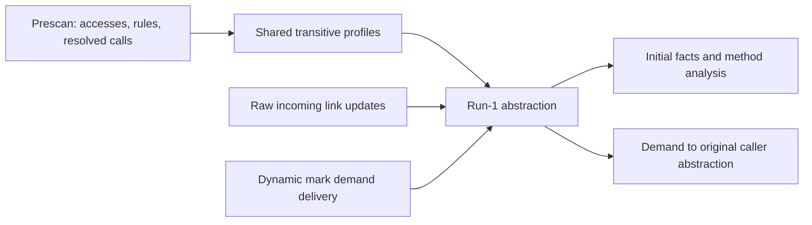

# Run-1 demands owned by initial fact abstraction

Date: 14 October 2026. Status: detailed redesign and implementation proposal. No runtime change
or new measurement is included. This design follows the user's selected direction and supersedes
the static request-routing and request-component candidates in the
[earlier investigation](bidirectional-run1-request-management-20261014.md).
The [implementation plan](bidirectional-run1-abstraction-demands-plan-20261014.md) gives the work order.

## Result and measured target

Remove static position requests. Prescan collects the static accesses and rule static positions
of each method. The resolved call graph supplies transitive static needs. Run-1 abstraction uses
these needs when incoming facts arrive, and emits the required initial facts directly.
It must also emit the static-root initial `(S, [], STAR, Empty, STAR)` for every admitted static
input, including when the method's transitive static sets are empty. Precise static initials
are additional emissions; the root provides the summaries that carry static state through calls.

Also collect static mark interests from rule checks. Abstraction owns these interests and any
remaining dynamic mark interests. A delivered request becomes a completed policy update; it is
not a separately indexed standing request awaiting a future answer.

**Current versus new behavior**

| Area | Current | New | Expected benefit |
| --- | --- | --- | --- |
| Static positions | Discover, store and climb position requests during run-1 | Use shared transitive prescan profiles in initial emission | Remove runtime position traffic, request rows and their path index |
| Marked static inputs | Initially emit the static root; request concrete marks later | Keep the static root and add actual marked suppliers for accessed/rule static positions | Avoid request round trips before an available static fact can be analysed |
| Static rule marks | Discover interest when a FLOW fact reaches a check | Install precomputed static mark interest in abstraction | Share the interest and suppress delivery to already covered static abstractions |
| Other mark demands | Keep exact memberships in N1 and join them with raw links | Update the original abstraction's compact mark policy | Complete transport work; keep future emission coverage with one policy per simple chain |

The measured runtime is `a23ad7fcd99553190c82557cff6076503959aec6`. Its ThingsBoard capture is from
**run-1, forward, limit 1**, before OOM, with no completed iteration or accepted report. N1 retains
2,267,943,216 bytes, including 2,401,903 singleton position rows and 17,573,638 mark memberships
in 188,247 mark rows. Positions account for 92.73% of rows. The byte union includes both kinds
and their indexes; it is not an isolated position-byte estimate.

The latest measured progress remains:

| Project | Latest reached | Last completed engine and accepted report | Run-1 engine |
| --- | --- | --- | --- |
| OWASP | run-3, forward, limit 3 | run-3, forward, limit 3 | 336.977 s |
| Conductor | run-2, backward, limit 2; OOM | run-1, forward, limit 1 | 75.939 s |
| ThingsBoard | run-1, forward, limit 1; OOM | None | Incomplete; 226.938 s includes capture |
| Stirling-PDF | run-4, backward, limit 4; timeout | run-3, forward, limit 3 | 47.389 s |

These are baseline measurements, not results for this design. The acceptance target remains a
complete run-1 engine within 60 seconds, starting at limit 1. Prescan and report time are separate.

## 1. Freeze prescan metadata

Use the calls already resolved during prescan. Do not resolve them a second time to construct the
catalog. Export their method-level adjacency, with the union of targets across all prescan
contexts and frozen lambda targets. The current `JIRBidiAnalysis.PrescanResult` exports rules,
lambdas and roots but does not export this adjacency; extend that handoff.

The existing edge source is the legacy runners' internal and external summary subscriptions.
Resolved concrete and lambda calls both register there. Export their callee/caller relation with
`collectCallers(false, ...)` after joining; project the copied edges to method identities before
prescan owners are released. No second graph-resolution pass is needed.

The graph contract is completeness for the executable methods and call targets of this analysis.
Keep the existing policy for unresolved calls and class initializers. Include the generated
Spring dispatcher, wrappers, registry operations, initialization and cleanup, and the transformed
lambda/concat methods that the analyzer executes. A nominal declared callee is not a substitute
for the already resolved targets. Collection runs after transformations and root generation.

Copy metadata only after prescan has joined successfully and before its owners are released.
Retain method identities, static class/field descriptors and rule mark identities. Do not retain
prescan contexts, subscribers, alias analyses, facts, forms or numeric IDs from its AP manager.
Convert descriptors once with the new core's accessor and mark managers.

Every runtime resolved target must belong to the exported adjacency. Treat a coverage violation
as a catalog contract failure, with no successful report. The selected design has no silent
fallback to an incomplete catalog. Test this invariant at the existing call-plan boundary.

## 2. Collect direct static needs

Collect actual static field accesses from each transformed method, including writes. Use the
same declaring-class and field conversion as `MethodFlowFunctionUtils.mkAccess`, so inherited
fields use their actual owner. A deep access contributes its static field slot `[<C>, f]`.

Collect bound static positions from the effective statement, call, entry and exit rules too.
This includes positions in source and sink conditions, pass rules, source actions, cleaner
actions, strong-write/RemoveAllMarks keep edges, generated call cleaners and return rewriters.
The class-only keep position `[<C>]` is distinct from the field position `[<C>, f]`.

Use the existing validation, binding and condition normalization. Enumerate the live NNF leaves;
do not expand cubes. Keep normal rule selection and `allRelevant` return-rewriter selection as
separate inputs with their current eligibility. A false normalized rule contributes no executable
rule effect; `P AND NOT P` can fold to false. Ordinary program accesses remain present.

The local profile has three logical parts:

```text
StaticAccesses(m): static positions read/written by code or used by effective rules
StaticAbstractions(m): positions needing a STAR initial, including class keep positions
StaticMarks(m): marks requested by static rule checks/gates or applicable static cleaners
```

The collector keeps access and structural roles distinct. A class-only keep operation must not
by itself turn every field in that class into a concrete-access interest. Root and class-wide
rule positions, when actually present, retain their wider meaning. Position slots have at most
two accessors; full rule literal paths remain in the rule evaluator.

For `StaticMarks`, include active static `ContainsMark` and `ContainsMarkOnAnyField` leaves of
both sources and sinks, concrete input-mark gates, and selected cleaner marks. Include the
required static read positions and mark effects of lowered field actions. F75 interest from a
primitive STATIC cleaner is base-wide: it cannot be limited to the cleaner's spatial position
or filtered by its mark exclusion. All-marks cleaners have no selected-mark request to add.

Marks remain interest, not proof. The catalog does not satisfy an AND or OR condition, trigger
a source or sink, or replace occurrence-specific bindings and support.

## 3. Compute shared transitive profiles

For each profile part `N`, compute:

```text
N(m) = LocalN(m) union union(N(callee))
```

Thus a caller knows its own needs and the needs of every transitive callee before run-1 starts.
Compute call-graph strongly connected components, union direct needs within each component, then
process the component DAG from callees to callers. A method profile can be shared across its
contexts because it is the union of potential needs, not runtime facts or support.

Keep one immutable profile per component and share equal sets and unchanged set parts. Use
sparse sets of analysis-local position/mark identifiers. Do not copy a transitive set into every
actor, construct a position-by-mark Cartesian product, or allocate an array spanning an assumed
small global mark universe. The initial representation must support sharing during union;
measure physical cells and object headers, not only logical cardinality. Use ordinary set
membership rather than a new spatial request index.

Profiles contain no compiled rule occurrences, CallPlans or InitialAp objects. Metadata lives
through run-1 and is released after its workers join; later iterations keep only data that their
existing forms and handoffs require. Charge collection and closure time to the existing overall
analysis budget, and report it separately from the run-1 engine.

## 4. Make abstraction the emission owner

Introduce a method-scoped run-1 abstraction service at `RunMethodAnalyzer.emit`. Keep restricted-run
demand emission on its current path. The service consumes admitted raw-link updates and the
immutable method profile, and emits through `addInitial` and its existing deduplication.



Keep raw added facts, link layers, caller layers, full MethodKeys, original caller premises and
call sites in their existing owners. A profile is not a supplier. It never generates a concrete
mark from a FLOW fact or from catalog membership alone.

Retain the static-root identity path for fields outside the callee's profile. A caller can read
`D.f` after a callee that never accesses `D.f`; the callee must still return that untouched state.
The catalog selects precise analysis work, not which raw links or static identity effects exist.
Root emission is mandatory and independent of catalog membership. Deduplicate the root with the
existing initial-fact store, then analyse its normal FLOW start using the current keep, kill and
exclusion rules. A summary is computed from those rules; it is not an unconditional identity
shortcut that could bypass a static write or cleaner.

### Abstract static position emission

Keep the current zero and root policy emissions. For an admitted raw static leaf at path `r`,
emit `(S, q, STAR, Empty, STAR)` for the required structural positions `q` at or above `r`.
This is the current position-answer operation moved to abstraction. For class/field slots the
candidates are the first one or two prefixes of `r`; test profile membership directly.

An abstract root or proper-ancestor leaf does not justify a deeper position answer. Emit no
`S.q.STAR` merely because the catalog mentions `q`. Instead, callers already have `q` in their
transitive profiles. When a caller receives a supplier at or below `q`, it emits the precise
initial there; its facts and summaries then supply callees through the ordinary call machinery.
Preserve exclusions when matching suppliers. A fact above an excluded field supplies nothing
for that field.

Remove the position-request action from the root/class static exception in `EdgeApplication`.
Retain its no-result behavior on that parent FLOW branch; allowing the ordinary deep-read
fallback there would introduce the forbidden wide static DEMAND result. The required precise
initial comes from abstraction, not from the parent branch.

### Concrete static emission

For an incoming marked static leaf that overlaps an accessed/rule static position, admit the
actual leaf as a concrete initial using the existing static answer/start rules. This is eager
concretization of an actual supplier. Do not replace it by a fact at the check's position.

For example:

```text
x = C.g
C.f = x
check ContainsMark(C.f, T)
```

`C.g` and `C.f` are collected accesses. An incoming `C.g.$(T)` is admitted at `C.g`, then ordinary
read and write transfer moves its mark to `C.f`. No backward field-dependency analysis is needed.
The same emission supplies `x = C.g; sink(x, T)`, whose check has a local base.

An EXACT concrete leaf keeps its full path and starts in NORMAL. An ANY leaf keeps its full path
and starts in DEMAND. An incoming ANY_TAINT/must leaf becomes ANY with an empty initial exclusion,
and starts in DEMAND; run-1 does not admit must initials. Keep the supplier's original E and
layers in the raw store for matching and support. Deep answers are not cut to the field slot.

For a wide concrete ancestor that genuinely overlaps an access, retain its actual shape and use
the existing answer kernel for any active chain-specific answer. Do not invent a deeper EXACT
fact. Root/class EXACT facts do not supply their descendant fields.

Eager emission can create more initials and body work than the old lazy mark requests. Measure
that tradeoff. Initials still carry their original nonzero premises; ordinary support decides
whether a witness is supplied. Do not turn catalog interest into a zero-premise source fact.

## 5. Install static mark policies; deliver remaining marks to their origin

Install `StaticMarks(m)` as a shared static abstraction policy, including the static root and
active emitted static position chains. Reuse one immutable mark set; do not expand it into N1
memberships for every static position. For its concrete suppliers, apply the same answer rules.
F75 base-wide interest can require marked suppliers outside the cleaner's spatial position.

For a matching abstract link, retain the original geometry and mark-exclusion test. Its mark
demand belongs to the raw caller's original abstraction. There are two cases:

1. That exact caller abstraction is already covered by its installed static profile. Its existing
   emission policy observes current and future suppliers, so no demand message is needed.
2. The original abstraction is not covered. Deliver a merged mark set to that full MethodKey and
   original chain. For example, `Arg0` written to a static field still needs a mark demand at
   `Arg0`; adding interest to the caller's static root would not obtain that answer.

Do not infer coverage just from the caller method or the literal's static base. The target
initial, mark set and activation must be covered. A more specific chain may need a proper-ancestor
answer that a root-only policy does not provide. Keep its dynamic demand until that policy is
explicitly covered.

Local-base checks, static-derived local checks, and any demand outside the precomputed policy
use the same dynamic delivery protocol:

```text
RequireMarks(full MethodKey, original simple initial chain, mark set)
```

The receiver abstraction unions fresh marks into its policy, processes existing suppliers,
and observes later admitted raw links. Request initials already have STAR tail, Empty exclusion
and STAR mark. Nonstatic chains are policy roots; static chains are roots or class/field positions.
Use a compact base/position key and a mark set. No RequestPathIndex, origin directory, per-mark
ordinal columns or separately retained request objects are needed.

### Completion and batching

A delivery closes after its policy update and bounded processing have committed. Release the
message and temporary set then. The small dynamic interest set remains part of abstraction so
future suppliers can emit new facts. A static catalog represents that interest without separate
actor membership copies. This does not claim that a dynamic interest can vanish after one answer.

Installing a precomputed policy must actually process existing links and subscribe to future
updates. Do not mark it as satisfied and then deduplicate a later real demand while skipping its
link processing. Separate installed membership from pending processing progress.

Batch fresh marks, raw-link changes and outgoing demands under the existing method work barrier
and bounded quantum fallback. Combine equivalent outgoing targets after raw eligibility checks;
retain independent original initials and contexts. Keep a captured committed horizon for each
detached phase, and put reentrant updates into the next phase. Do not add a run-long per-target
sent-mark history. No pending abstraction continuation may remain when a run is marked complete.

## 6. Migration, proof and measurement gates

Position catalog emission is a new policy, not the old Position protocol with renamed stores.
Keep the old scalar engine as an oracle during migration. Project removed transport observations
from comparisons, but retain required answer/fact coverage, source and sink witnesses, support,
native records and run-1/backward-run-2/forward-run-3 handoffs. Additional eager initials require
an explicit support and refinement check; do not silently loosen equality tests.

First remove position requests. Then enable eager concrete static emission and precomputed static
marks. Then migrate remaining mark ownership. This order isolates failures and measures each
effect. The plan names tests for late suppliers, argument-to-static origins, excluded fields,
deep/must answers, NNF sources and sinks, cleaners, generated methods and context separation.

Measure catalog construction time, physical profile storage/sharing, peak heap, GC, emitted
initials, analysed facts, dynamic mark policies, mark deliveries, and eliminated position events.
The catalog must not recreate the actor-by-position collection during setup. The 2.268 GB N1
union is a target population, not a promised saving; raw stores and additional emitted facts stay.

Retest the fixed OWASP, Conductor, ThingsBoard and Stirling-PDF configurations with Gradle
`runProjectAnalyzer`. Record latest reached, completed and accepted run-N for each project.
Preserve the strict baseline comparisons and diagnose any changed findings. An OOM, timeout,
missing required finding or incomplete run-1 fails the 60-second completion target.

IR storage, SoftReferenceManager and WeakIdentityCache are outside this design. The current
cleaner normalization and rule semantics stay in use. Broad queue changes remain deferred.
