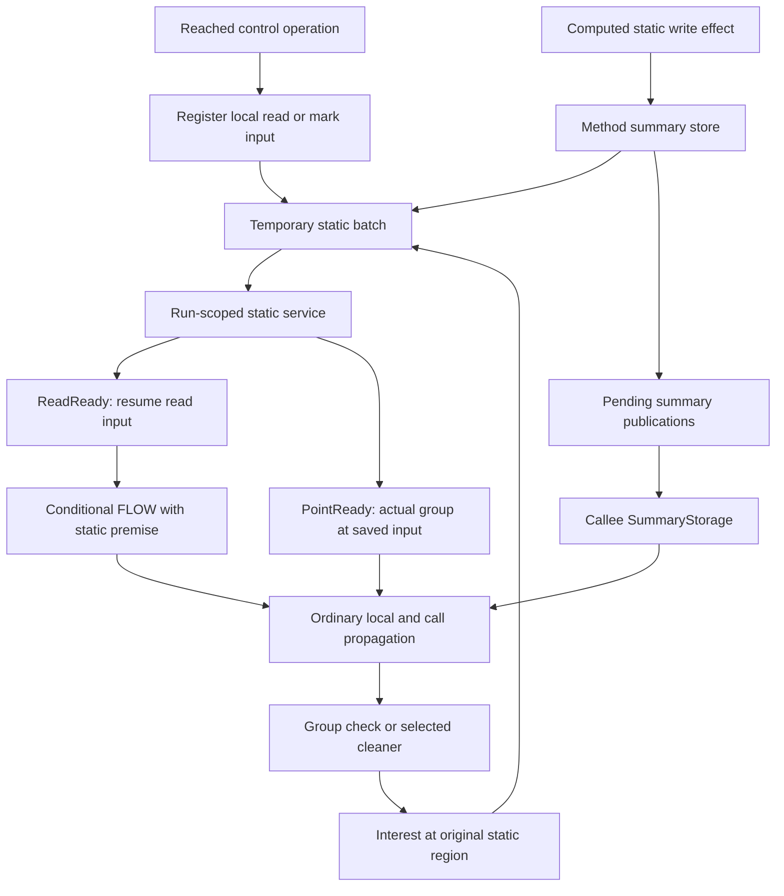

# Run-1 static workflow and storage

Date: 20 October 2026. This document describes the implemented runtime at
`029ee41fd6de17388c2f61d0f900cd00f6bd33f8`. Current HEAD `fa87a6b9d`
adds documentation only. This is an explanation, not a new semantic contract
or an implementation proposal.

The contracts are [grouped-run1-statics.md](../../spec/grouped-run1-statics.md)
and [immutable mark groups](../../spec/run1-group-policy-and-ownership-census.md).
The [next-iteration proposal](bidirectional-run1-redundant-work-next-iteration-20261020.md)
is not implemented. In particular, the current runtime still has separate
writer delivery maps, FLOW-mx-qualified point keys and append-only temporary
publication lists.

## 1. The three separate relations

Run-1 has three different kinds of static information:

| Information | Example | What it permits |
| --- | --- | --- |
| Reached write region | A computed value effect writes `C.f` | Admit a waiting read or field condition at `C.f` |
| Supplied group | A valid source/caller/static-summary derivation supplies `G` at `C.f` | Answer an interest for `G` at an overlapping region |
| Conditional ordinary summary | `parameter/FLOW -> C.f/FLOW` | Apply the relation to an actual compatible caller input; it does not itself supply a group |

A write region does not mean that any particular group exists. A request
does not supply a group. A conditional group premise does not prove that
its group exists. These distinctions prevent a request or an empty copy
cycle from generating its own answer.

The global service admits reads and joins supplied groups with interests.
Method owners execute the actual AP operations and retain their ordinary
summaries. All static-derived results are DEMAND.



### Notation

- `Z` is control ZERO. It is different from static base `S`.
- `F` is the abstract FLOW mark. `G` means `(topLevelRuleId, *)`.
- `C.f` means the AP `S.C.f`: class accessor, then field accessor.
- `I -> x/F` is an edge with original premise `I` and current FLOW at `x`.
- `I -> x/G` is the corresponding group-taint edge.
- `D` and `N` mean DEMAND and NORMAL.
- An ND summary has an all-of, multiple-member premise; all members and their
  ordinary compatible bindings are required.

Most example arrows omit tails to show dependencies. This does not replace
the actual AP grammar. The static FLOW premise is always `C.f.* / F`, with
empty E and mx. A group static premise uses an allowed EXACT or STAR shape
selected from the actual supply. No example introduces an ANY initial.
Source/current facts can have the ordinary exact, STAR, ANY or must geometry.

The legal static premise descriptors are:

| AP | Tail | Selector | Use |
| --- | --- | --- | --- |
| S.C.f | STAR | FLOW, empty mx | Admitted field read or field-condition dependency |
| S.C.f | EXACT or STAR | Group(G) | Actual field supply refinement |
| S.C | EXACT or STAR | Group(G) | Admitted class-point/region primitive only |

Their field E is empty. There is no abstract class premise, S-root premise,
ANY/must initial or second field accessor in a run-1 static initial.

Run-1 uses GROUP marks and field limit 1. A class accessor does not consume
that field limit. A group or static-dependent result is D. Independent
ordinary FLOW can remain N.

## 2. Setup and reached operations

Prescan resolves the calls and the ordinary call graph. The rule/provider
path loads immutable declarations, preserves original rule/action identities,
and selects GROUP forms for run-1. FULL forms remain available for later runs.

The lowerer attaches local operation descriptors:

```kotlin
StaticOperation.Read(id, transfer)
StaticOperation.Write(id, target, transfer, action)
StaticOperation.MarkInput(id, position)
```

An IR static load is a Read. An actual static value transfer is a Write.
A static operand in a source/sink condition or a selected-mark model is a
MarkInput. Alias/model value transfers to statics also need Write metadata.
A destination on a keep/preservation edge is not enough to classify a write.

Descriptors describe operations. Prescan does not publish their writes or
supplied groups. At execution, `Run1PointResume.reached` registers consumers
only when a genuine `Z -> REACH` item reaches the operation.

There is no transitive method-by-field request plan, static request slot,
static-need graph, or per-method inventory of all possible groups. The ordinary
entry abstraction starts ZERO and nonstatic entries. It skips static inputs;
static descriptors resume at an operation instead of a method entry.

## 3. Reached writes and summary publication

Consider:

```java
void set() {
    Object t = sourceT();
    C.f = t;
    doMoreWork();
}
```

Assume `sourceT` emits a mark in group G under its admitted rule condition.
Ordinary source/copy transfer produces `Z -> t/G`. At the static store:

```text
Z -> t/G
  actual write transfer
Z -> C.f/G, D
```

`EngineAlgebra.operationResult` matches the result to its Write descriptor.
`emitOperationResult` sends a static value to `summaryDelta`, rather than to
the next CFG statement. The summary path applies the existing run-1 cover
and field limit, then inserts it into the actor's ordinary summary store.

```text
summaryDelta
  -> bound the ordinary AP result
  -> RunSummaryStore.add(completePremise, result)
  -> stop on a null delta
  -> register each fresh static output selector
  -> queue ordinary summary publications and selected demand guidance
```

For the fresh `Z -> C.f/G` summary, the static batch contains write presence
and actual supplied G. A FLOW result publishes write presence but no group.
A nonzero conditional result keeps its original premise; it is not changed
to Z to make it a pool source.

An actual ZERO-rooted G is published even when nobody currently requests G.
The group pool is a union of derived supplies, not a demand-filtered subset.
A write-only method can therefore populate it. Conversely, a prescan Write
descriptor or an executed assignment with no computed FLOW/TAINT value
effect does not create a supply merely because its destination is C.f.

The summary is retained before normal method exit. Notification still waits
for the method-queue-empty barrier. The static current fact does not traverse
`doMoreWork`, and early publication is not proof that the method returns.
For a write followed by an infinite loop or throw, the reached effect can
still be published. It remains D.

No synthetic `C.f -> C.f` transport summary or executable `S.* -> S.*`
default is installed. Actual operations retain their ordinary transfers,
including a real self-assignment; this is not a blanket deletion of equal
premise/conclusion shapes.

## 4. Read admission

```java
Object get() {
    Object x = C.f;
    return x;
}
```

When ZERO reaches the read, its owner saves the operation input and registers
a read region. If no compatible reached value write exists, the read waits.
It emits no conditional static data edge yet. ZERO control and independent
source rules can continue.

When a write region is available, the service computes the spatial overlap
and sends ReadReady. The owner creates a legal `C.f.* / F` premise and
resumes at the read's input:

```text
read input:   C.f/F -> C.f/F, D
read output:  C.f/F -> x/F, D
return:       C.f/F -> return/F, D
```

This input is not an InitialFactStore method-entry seed. It is an
operation-local work item. The read output is not `Z -> x/F`.

Read admission uses write presence, not G. It can create this conditional
FLOW summary when only an abstract FLOW write exists. If G is needed later,
the corresponding operation requests it from the actual original region.

Both arrival orders work: a newly registered read joins old writes; a new
write joins waiting reads. ReadRow records each delivered overlap before
scheduling the owner. A later group at an already admitted region is handled
by group interests, without admitting the same read region again.

### Missing writes and late writes

```java
void readOnly() { sinkT(C.f); }    // No admitted producer in this example.

void readThenWrite() {
    Object x = C.f;
    C.f = sourceT();
    sinkT(x);
}
```

With no compatible write, readOnly retains a dormant read and produces no
group candidate from that read. In readThenWrite, the late write can wake
the earlier read. Run-1 can produce a D candidate even though the store is
later in program order. The pool deliberately approximates that order.
Handling both arrival orders also covers ordinary scheduling differences
when the actual writer executes earlier in the program.

## 5. Static-origin local flow and direct group refinement

```java
void consume() {
    Object x = C.f;
    Object y = x;
    sinkT(y);
}
```

After read admission, ordinary forward transfer gives:

```text
C.f/F -> x/F
C.f/F -> y/F
```

These are local current facts with a static original. They propagate through
ordinary nonstatic statements. The ban on static CFG relay applies to the
current base, not to every edge whose original is static.

At `sinkT`, a check for G on FLOW calls `needGroups`. It saves:

```text
original:     C.f.* / F
current:      y/F with its actual geometry, layer and FLOW mx
resume site:  this sink's actual operation input
wanted:       {G}
```

The service interest is on original `C.f`, even though the current value is
`y`. When an actual compatible C.f/G supply arrives, PointReady:

1. selects a legal concrete/group premise from the actual supply;
2. uses the saved `C.f/F -> y/F` relation to materialize the group image;
3. clears FLOW mx for this DEMAND repair relation, as the current code does;
4. enqueues `C.f/G -> y/G, D` at the saved operation input;
5. re-executes the check and its ordinary rule logic.

The original's FLOW selector is replaced by the supplied group selector.
A group current fact is never placed under an unchanged FLOW premise; the
ordinary premise/conclusion kind invariant is preserved.

It does not restart consume or get at method entry. It does not scan backward
from the sink to find a writer. The earlier forward FLOW edge already names
the original static query and the relation to the current value.

A compatible H supply does not answer G. A request with no actual G remains
dormant. The current point key includes saved mx even though materialization
clears it; removing that redundant key distinction is only a future proposal.

## 6. Getter summaries and caller ZERO

Use the complete example:

```java
void main() {
    static_set();
    static_consume();
}
void static_set() {
    Object t = sourceT();
    C.f = t;
}
void static_consume() {
    Object t = static_get();
    sinkT(t);
}
Object static_get() {
    return C.f;
}
```

The main events are:

```text
static_set:
  Z -> t/G -> C.f/G, D
  retain early Z -> C.f/G summary
  publish write presence and actual G to the global pool

static_get:
  admitted read -> C.f/F -> return/F, D
  retain ordinary getter summary

static_consume, at the getter call:
  genuine Z/REACH caller control activates that conditional FLOW summary
  retain the callee's static original: C.f/F -> t/F, D

static_consume, at sinkT:
  request G using original C.f and current t/F
  pool answers -> C.f/G -> t/G, D at the sink input
  sink observes a group DEMAND candidate
```

ZERO supplies control activation only. It supplies neither C.f nor G as a
taint source. The resulting edge retains the static premise.

At the setter call, the ordinary ZERO-premise summary also gives main an
early `Z -> C.f/G` summary. This preserves ordinary caller summary/guidance
relations. The pool need not wait for that outward summary: the setter's
own legitimate ZERO-rooted effect already supplies it.

If the sink's local `t` is dead afterwards, consume need not have a return
summary with a C.f premise. The sink occurrence is retained independently.
This matters for the run-2 ZERO-discovery path in section 15.

### How old and late summaries reach callers

At a reached call, the caller stores its actual input subscription and
subscribes to the callee's SummaryStorage. Registration precedes replay of
existing publications. A new publication later notifies that subscriber.

For genuine run-1 ZERO control, `staticCandidates` selects static-premised
summaries from the existing publication index. There is no second special
static-summary store. FLOW static summaries use `applyStaticSummary` directly.
Nonstatic results run through the remaining ordinary call stages. A static
result is retained as a new early caller summary instead of a CFG successor.

This ZERO exception applies only in run-1. In later runs a C.f premise needs
an actual matching C.f fact.

### A call that does not touch statics

```java
void main() {
    C.f = sourceT();
    pureHelper();
    sinkT(C.f);
}
void pureHelper() { doLocalWork(); }
```

Run-1 need not send C.f through pureHelper, subscribe it to a static input,
or create a C.f identity summary there. The pool still has the reached supply
when the later read/check is admitted. Productive effects and local
static-origin nonstatic values still use the ordinary paths described above.

## 7. A summary with a group-valued static premise

Assume an admitted modeled rule has this relation:

```java
Object make() {
    // Rule: when C.f has group G, emit an output in group H.
    return modeledOperation();
}
void use() { Object x = make(); sinkH(x); }
```

```text
callee summary: C.f/G -> return/H, D
```

Caller ZERO cannot turn this into `Z -> x/H`. `callInterest` stores the
caller-qualified publication leaf, matched static member and resume state.
It subscribes to the required input G at C.f.

When actual C.f/G is available, `staticSupply` runs the ordinary complete AP
match, selects the legal static group premise, applies the summary, and
resumes the caller suffix. The result remains conditional on the actual
static input. It can be `C.f/G -> x/H, D`.

This interest requests the summary's input G, not its output H. Different
output leaves, caller references, layers and ND member ordinals remain
separate routes. A late marked summary and a late supply both use the same
standing join protocol.

## 8. Nonstatic writers: ordinary actual inputs and the request bridge

### An actual marked caller input needs no Base request

```java
void set(Object p) { C.f = p; }
void main() { Object t = sourceT(); set(t); }
```

```text
set summary:        p/F -> C.f/F, D
actual caller item: Z -> t/G
ordinary binding:   p receives that actual G
ordinary result:    Z -> C.f/G, D
```

The caller stores the actual input before entry abstraction. Ordinary FLOW
summary application carries its G to the output. It does not need a marked
callee initial or an explicit Base(p)/G request first. The caller publishes
the static result and, with original Z, supplies it to the pool.

### An unresolved ordinary original uses P/R

```java
void A(Object q) {
    set(q);
    consume();               // Eventually needs G at C.f.
}
void main() { A(sourceT()); }
```

Analysis can first obtain `q/F -> C.f/F` without a concrete G. This is a
conditional FLOW writer, not a pool supply. Its output region is indexed as
a StaticFlowWriter. An overlapping static interest for G sends WriterInterest
to that writer's owner:

```text
static interest C.f/G
  + current q/F -> C.f/F writer
  -> temporary ordinary request Base(q)/G
  -> SummaryStorage's cumulative request store
  -> ordinary caller-input replay / outward request joins
```

Actual matching inputs answer the ordinary request. Actual ordinary caller
summary composition is still required to produce a pool supply. Merely
analyzing a hypothetical q/G initial is not enough.

The bridge applies only to a legal singleton ordinary FLOW original and a
mark-preserving FLOW output. A concrete, ND, mixed or GEN writer must keep
its full relation; it cannot copy the requested output group to every input.

### An ordinary helper request can return to a static original

```java
void check(Object p) { sinkT(p); }
void consume() { Object x = C.f; check(x); }
```

The helper stores `Base(p)/G`. In consume, its ordinary actual-input
subscription is `C.f/F -> x/F` at the call. Request replay recognizes the
static original and calls `requestStaticGroups` at that exact caller input
stage. This becomes a direct C.f/G interest. It does not add a static P/R
slot or propagate a request up an unrelated static call chain.

## 9. Static-to-static copies and complete joins

```java
void copy() { Object t = C.g; C.f = t; }
void main() { C.g = sourceT(); copy(); consumeF(); }
```

Read admission and normal forward transfer produce:

```text
C.g/F -> t/F -> C.f/F, D
```

The static conclusion is an early ordinary summary. Its complete premise is
all-static, so its owner registers a StaticWriterRegistration.

When the pool has actual C.g/G, the service selects a candidate input tuple
and sends WriterReady. The owner borrows the current summary selected by
its WriterKey, rechecks AP matching, applies the ordinary summary, bounds
the result, and supplies the actual computed C.f/G image.

The FLOW copy can carry every actual source group without a mark request
and without a separate marked copy summary. The service itself does not
execute the copy or interpret the source rule.

### Multiple static inputs

```java
void conditionalWrite() {
    // Rule condition: CM(C.a,T) AND CM(C.b,U).
    // Assume T and U project to G. Action writes an admitted result to C.out.
    modeledOperation();
}
```

```text
{C.a/G, C.b/G} -> C.out/G, D
```

The service needs a complete ordered tuple of candidate regions and groups,
one for each canonical premise member. The owner checks all members before
ordinary `applyCombination`. Only C.a/G is insufficient. One member's AP
match cannot stand for another member.

For mixed static/nonstatic premises, the service does not invent a binding
from its static pool. Ordinary compatible caller/ND joins carry the complete
unresolved relation outward. For example, `M(marked, clean)` and
`M(clean, marked)` do not jointly satisfy one two-argument writer call.
Only a legitimate ZERO result or a completely satisfied all-static result
can enter the supplied-group pool.

### Empty cycles

```java
void cycle() {
    C.f = C.g;
    C.g = C.f;
}
```

Neither descriptors, FLOW relations nor requests invent a first G. If actual
write regions/relations are available, they can stand waiting, but group
closure still needs a real source/caller derivation. A later valid G can
activate the forward copy closure. The pool records memberships, not a
proof tree or a global graphChanged replay history.

## 10. Direct static conditions, sources, models and aliases

```java
void check() { modeledCheck(); }
// Sink rule condition: CM(C.f, T).
```

There need not be a separate IR `x = C.f`. MarkInput supplies a reached
local consumer at the actual rule stage. For a field-shaped operand it uses
write-presence read admission, then FLOW checking and direct group refinement.
It is not a precomputed static field request and it creates no static P/R row.

A class-point operand `S.C` has no legal abstract class FLOW initial. Its
MarkInput uses a direct interest in the required group instead. The owner
installs only legal group descriptors selected from actual compatible supply.
An exact empty `S` taint atom remains invalid.

A conditional source follows the same check/refinement path as a sink.
Its result keeps the original accepted singleton or complete ND premise.
An unconditional, actually admitted static source can publish `Z -> C.f/G`
without an IR store. Configuring a source alone does not execute its condition.

Absence from the supplied-group pool is not a proof of `NOT CM(C.f,T)`.
Non-mark conditions and eligible negative/residual rule handling retain the
ordinary rule policy. Later seeds retain the original FULL predicate.

Static reads/writes from pass-through models, call aliases and boundary
rules enter at their exact form/action stage. Stable OperationId and
ResumeSite retain action, stage, cleaner substep and phase. An alias write
is published only when its existing ordinary transfer produces a value.
The static service does not introduce another alias or field transfer.

## 11. Cleaners, overwrites and the global approximation

```java
void consume() {
    Object x = C.f;
    cleanSelectedT(x);
    sinkT(x);
}
```

A selected-mark cleaner requests G at its actual input, including when G is
already in FLOW mx. Its FLOW complement excludes G; an actual G survives as
D because a group cannot be removed by that selected cleaner in run-1.
For a static original the interest uses the saved original/image/site, as
in section 5. A late reply resumes the cleaner's proper input/read/clean/write
phase and runs the remaining operations. It is not injected after the kill.

RemoveAllMarks can kill under its existing actual admission rules. Ordinary
definite field hits also kill. The selected run-1 field rule remains:

```text
x.f = y:
  x.*    N -> D, retain empty field E
  x.f.*       killed by a definite overwrite
  x.g.*       preserved when f and g are disjoint
```

There is a separate global static approximation:

```java
void main() {
    C.f = sourceT();
    C.f = cleanValue();
    sinkT(C.f);
}
```

The pool retains historical C.f/G supply. It does not retract it on the
second write, apply global strong kills, or enforce call order/caller context.
Run-1 can therefore retain a D candidate here. This does not change the
ordinary local AP overwrite rule into an all-writes-are-weak rule. Run-2 uses
the actual FULL CFG/call transfer and strong overwrites to refine candidates.

Likewise, a reached writer and consumer in different call order or caller
contexts can communicate through the pool. Every delivered group still
needs a source/writer derivation. Mere group membership in MarkTable is not
a supply. No static-derived run-1 candidate is a confirmed exact finding.

## 12. All storage owners and their organization

### 12.1 Immutable metadata and forms

| Storage | Organization and use | Why this organization is needed |
| --- | --- | --- |
| Mark declarations and MarkTable | Serialized full-name ownership; immutable keys; small FULL/GROUP/zero interner. Group name encodes uniform primitive tracking. | Stable group identity without loading/specializing every method to discover ownership. No eligible-member or all-group enumeration. |
| Ordinary prescan/call graph | Resolved calls, method keys and local operation metadata. | Reuse normal method discovery and actual call bindings. It is not a static-routing transitive closure. |
| GROUP/FULL form caches | Existing method/form cache with distinct rule views; local Read/Write/MarkInput descriptors. | Later FULL rules remain distinct from run-1 GROUP forms. Stable operation IDs let a reply rebuild an evicted form. Continuations need not retain full call plans. |

### 12.2 Method actor and ordinary caller state

| Storage | Physical organization and use | Why it is retained this way |
| --- | --- | --- |
| InitialFactStore | Set of canonical method-entry InitialAp handles. Run-1 entry admission is ZERO/nonstatic only. | Deduplicate actual entry starts. Operation-local static premises are not method-entry memberships. |
| MethodEdgeStore | Complete canonical premise -> statement-slot array -> ConclusionGroup; REACH uses layer bitsets. TAINT paths/marks are packed in tries. | Deduplicate and compute ordinary semantic deltas per statement without losing original/ND correlation. Static-origin nonstatic current facts use this store. Static current effects bypass successors. |
| DeltaWorklist | Queued statement deltas and bounded unchanged-repeat work. | Execute fresh local work and the existing finite unchanged path; no static relay queue is added. |
| RunSummaryStore.groups | Complete premise -> merged ConclusionGroup of raw computed summaries, including early static effects. | Authoritative current owner relation, NORMAL record input and WriterKey rechecks after replacements. |
| RunSummaryStore.demand | Separate complete-premise merged selected publication relations. All run-1 pieces are selected. | Build the run-to-run demand handoff. addDemand alone is not publication to callers. |
| pending publications | Actor ArrayList of Publication(premise, piece), replaced when detached at flush. | Existing method-queue-empty notification batching. Currently it retains intermediate accepted deltas until that barrier; it is not a merged temporary map. |
| Callee SummaryStorage | One per full callee MethodKey in RunManager; lock protects PublicationIndex, subscriber set and cumulative ordinary requests. | All caller units see one published relation; subscribe-before-replay plus notifications covers both arrival orders. No separate static summary copy. |
| PublicationIndex | Complete premise -> merged ConclusionGroup; PathTrie entries contain complete premise plus member ordinal. | Locate candidates while preserving complete ND premises. staticCandidates borrows the static-member portion of this same index. Full AP checks still run afterwards. |
| Caller SubscriptionManager/CalleeSubscriptions | By callee; AddedFactAccumulator retains exact caller-qualified actual input groups. PathTrie indexes handles; separate zero-only ports support ordinary backward discovery. | Apply summaries to actual pre-abstraction input, preserve call/stage/caller-layer correlation, replay old summaries/requests, and meet late publications. No duplicate callee input history. |
| Temporary ordinary RequestStorage P | Actor-write-only Base(nonstatic original) -> merged group set. | Collect fresh nonstatic mark needs, including static FLOW-writer bridge results, before the existing barrier. |
| Cumulative ordinary RequestStorage R | Inside SummaryStorage; same class, Base -> merged group set. | Join old/new actual caller inputs and requests. There are no static, tail, E, mx or conjunction request slots. |
| ConjunctionStore and RulePredicateStore | Existing operation/rule-qualified partial bindings and compatible complete premise combinations. Caller ND summaries retain matching call/stage bindings. | Preserve real AND conditions and source/sink occurrences. An unrelated input or a group bit cannot stand for a complete ordinary binding. |
| Sink witnesses and seed metadata | Ordinary vulnerability store plus original rule/occurrence and grouped witness premises. Exact source-hit storage is used in later backward runs. | An internal sink survives even without a return summary; later FULL seeds use original predicates/action identities. Sink end-fact actions stay disabled. |

### 12.3 The per-method Run1PointResume directory

One actor owns one directory. Its local monotonically assigned IDs are
qualified by MethodKey in service rows and replies. There is no actor callback
stored in the shared service.

| Maps | Key and retained value | Purpose and key distinctions |
| --- | --- | --- |
| readKeys / reads | (ResumeSite, StaticOperation) -> id; id -> OperationInput plus operation | Wait for read admission and resume the exact original read/condition stage. Repeated visits reuse the descriptor. |
| pointKeys / points | (site, original InitialAp, current image Pattern, layer, CallResumeState) -> id; id -> PointContinuation with one-leaf current FLOW | Reconstruct the group image at the precise surviving operation input. Site, tail, E, current mx and call/cleaner state are currently key distinctions. |
| writerKeys / writers | (complete premise, exact static output Pattern, layer) -> id; id -> WriterKey | One reference per fresh selected output leaf. Borrow current raw summaries rather than retain an old cumulative Facts snapshot. Current FLOW mx, output geometry and layer remain part of the selector. |
| callKeys / calls | (callee, CallerRef, link layer, complete publication premise, output Pattern/layer, member) -> id; id -> subscription, one-leaf publication and member | Apply a group-valued static-premised callee summary after actual group supply. Do not lose caller or ND-member identity. |
| direct | id -> OperationInput for the class-point case | Group refinement without an illegal abstract class initial. |
| resumeQueue | PointWork(premise, facts, site, call state) | Schedule actual resumption on the owner. Dispatches statement, boundary, call stage and cleaner phase separately. |

CallResumeState contains callerLayer, nullable identityCandidate and
pendingDemotion. OperationId contains form, stage, optional ActionId and
substep. These are needed because resuming a call at a different phase can
rerun a cleaner, lose a guard, or change alias/demotion behavior.

WriterKey is a selector into the current ordinary summary. A canonical merge
can make a previous selector obsolete. `currentValues` then returns no value
and the old reply does no transfer. A new semantic replacement has its own
fresh selector. No old whole-summary root is kept just to answer that reply.

### 12.4 The temporary StaticBatch

Each method actor has these write-only lists:

```text
reads        StaticReadRegistration(owner,id,region)
interests    StaticInterest(owner,id,region,wantedGroups)
writes       reached write-region Patterns
supplies     RegionGroups(region,actualGroups)
writers      StaticWriterRegistration(owner,id,completePremise)
flowWriters  StaticFlowWriter(owner,id,outputRegion)
```

The current class uses ArrayLists. Cumulative deduplication happens on commit
in the shared service. The actor replaces the batch only after commit, then
secures all returned owner-event sends. This avoids reentrant cross-owner
execution during an ordinary local operation.

### 12.5 The single run-scoped Run1StaticService

| Store/index | Actual organization | Use and reason |
| --- | --- | --- |
| writes / writeIndex | LinkedHashSet<Pattern> plus positional PathTrie | Historical union of reached value-write regions. Separate from groups so abstract FLOW writes can admit reads without fabricating taint. |
| groups / groupIndex | Pattern -> GroupSet plus positional PathTrie | Rooted actual group memberships, merged per region. Geometry is separate from the group set; group count does not multiply identical region entries. |
| reads / readIndex | (owner,id) -> ReadRow; region index; delivered HashSet<Pattern> | Standing control-reached readers. Deliver each actual overlap once; a bare field name would lose tail/region distinctions. |
| interests / interestIndex | (owner,id) -> InterestRow; wanted GroupSet; delivered Map<overlap Pattern,GroupSet>; region index | Meet both new groups and new wanted groups. One answer at one overlap does not close other images or future groups. |
| writers / staticDependents | (owner,id) -> WriterRow with complete premise; delivered Map<ordered input-region tuple, group-set vector>; each premise member indexed | Apply all-static conditional summaries on pool growth. Keep complete member correlation and only revisit spatial dependents. Currently each output registration owns its own delivered map. |
| flowWriters / flowWriterIndex | (owner,id) -> FlowWriterRow with output region and delivered GroupSet | Bridge static output interests to an ordinary singleton FLOW original. The reply is a request, not a group supply. |

These PathTrie indexes use base/path to find positional candidates. They
do not prove mark, tail or exclusion matching. Reads/interests use the
service's region intersection. All-static writer owners additionally perform
the full ordinary AP match before transfer. An exact ancestor cannot supply
a descendant. E is checked by actual region/AP operations; ignoring E/mx in
ordinary request propagation does not remove those checks.

For writer-interest routing, the request join intentionally ignores field E
and FLOW mx, as ordinary request propagation does. It still supplies no taint.

The service is global because run-1 deliberately over-approximates static
call order and caller context. Current ordinary caller inputs, actual AP
composition and complete ND dependencies remain separately owned. A global
boolean per method or field cannot replace those relations.

### Why wanted and delivered are separate

```text
point wants {G}
pool supplies C.f/G     -> deliver G for that overlap
point later wants {G,H}
pool already has H      -> deliver H immediately
pool later adds a distinct compatible exact region for G
                       -> deliver the new region/G too
```

InterestRow therefore records delivery per overlap, not only per group.
An ANY supply and a later EXACT supply can select different canonical group
originals and output geometry. The current implementation keeps the standing
subscription after its first answer. Deleting it on "G answered" is not valid.

Supplies and wanted memberships use group sets. For example, a pool region
can hold `{G,H}`, and one point can want `{G,H}`. The service sends only
fresh matching memberships; it does not enumerate all full marks in either
group. `facts` can pack several supplied groups into a TAINT tree. Ordinary
AP matching and output-leaf selection still preserve each premise/group
dependency; packed storage is not permission to mix complete bindings.

### 12.6 Required information versus implementation choices

Complete premises, actual AP geometry/groups, semantic layers, original
operation/caller identity, both arrival orders and late-answer behavior must
be preserved. A field-only key or one answered bit per group loses information.

The exact collection classes and amount of repeated bookkeeping are choices.
A separate delivered binding map per writer output is not itself a semantic
requirement. Neither are duplicate saved points that produce the same repair,
nor an unmerged temporary Publication list. These are the subjects of the
next proposal, with equivalence proofs still required.

Raw actor summaries, selected demand guidance and the shared publication
index serve different owners/consumers. They do not justify arbitrary
additional history. The current WriterKey borrows the raw relation; the
static service does not retain another cumulative copy of every summary.
The existing caller actual-input relation is also reused, not copied into
a new callee static-input store.

## 13. Commit order, owner replies and completion

The current method work loop is:

```text
drain saved-point resume work
drain ordinary method fact work
  quantum/zero-phase yield -> keep the same batches and reservation
flush pending summary publications
if publication processing made local fact/publication work: continue
commit ordinary requests P into R; replace P
commit StaticBatch; replace it
queue every returned StaticOwner event
finish only when local work and temporary batches are empty
```

This is a method-queue-empty barrier, not a unit-wide or global graph replay
barrier. A quantum yield alone does not publish or commit the batches.

Under its lock, the static service:

1. registers reads/interests/writers and joins each new side against old state;
2. unions reached writes and wakes matching reads;
3. commits supplied group growth, including write presence, then wakes interests;
4. revisits the all-static writers indexed by the changed regions;
5. records delivered overlaps/group vectors and returns immutable effects.

The producer sends those effects after unlocking. The addressed method owner
runs ordinary AP transfer and can produce another batch. No shared lock
borrows another actor's mutable summary store.

| Reply | What the owner does |
| --- | --- |
| ReadReady | Install legal abstract static premise and actual admitted read input at the saved stage. |
| PointReady | Route to the saved marked-call continuation, direct class-point input, or ordinary saved FLOW relation; then enqueue actual group work. |
| WriterReady | Borrow current static summary leaf, match the complete pool tuple, perform ordinary composition, and offer its computed group slices. |
| WriterInterest | Recheck current singleton FLOW writer and offer the requested group on its ordinary Base original. |

Every scheduled owner event/work item uses normal counted-work admission.
Fresh child work is reserved before the producer releases its own work.
Unanswered read/interest rows are dormant, not queued unfinished work.
Completion drains all enabled reads, joins, requests, publications, replies
and rule reevaluation. It does not require a supply for every waiting row.

After runners join, the service, caller subscriptions, resume directories
and temporary stores are released. On COMPLETE, frozen actor summaries and
witnesses survive for the driver handoff; method edges and entry stores do
not. An incomplete run does not provide an accepted complete handoff.

## 14. Why there is still substantial static-related work

No current-static CFG relay does not mean no static work. The current runtime
still retains and processes:

```text
ordinary local flow with a static original
getter/read summaries and caller suffix application
early write summaries and their outward caller composition
all-static writer registrations and candidate input tuples
per-operation saved refinement points and marked-call interests
ordinary Base request bridges, condition joins and group reevaluation
```

These are qualified by method, original, output, site, phase, caller and
region. Fifty groups do not bound their product. MethodEdgeStore deduplication
runs before fresh summary registration, but it does not merge different
owner/output endpoints or all saved operation points.

The [fresh report](../reports/bidirectional-immutable-mark-groups-performance-20261020.md)
found a 4,213,559,264-byte retained union for the thingsboard run-1 service
and saved-point owners. It contains 3,010,244 WriterRows and 2,200,055
PointContinuations. This is ownership evidence, not a claim that all rows
are duplicates or that the full union can be removed. Ordinary request
stores retain about 11.9 MB in that snapshot.

The proposed shared-premise matcher and repair-key quotient are future
optimizations of this workflow. They are not descriptions of the current
storage organization above.

## 15. Handoff to run-2

After COMPLETE run-1:

- Selected summary relations become ordinary backward demand patterns.
- Internal sink occurrences produce seeds using original FULL predicates.
- Independently valid N summaries can persist as records. Group/static-derived
  D summaries do not become independently valid N records.
- One symbolic static group demand family is enabled for all eligible method
  keys, including methods created later.

For an actual FULL query in group G, the symbolic pair is:

```text
entry: S / empty path / ANY  / Group(G)
exit:  S / empty path / STAR / Group(G)
```

This is demand permission, not an executable `S -> S` summary, initial fact
or supplied taint. DemandStore creates the relevant pair from the actual
FULL input or entry premise's owner. There is no method-by-field-by-group
matrix or global group enumeration. An actual current query also keeps its
ordinary admission/publication permission; old exit guidance cannot discard
its actual computed results.

The two patterns are the entry and exit of one paired permission, not two
emitted facts. The ANY entry is a matching pattern, not an illegal ANY
initial. The implicit pair keeps the same group on both ends. Explicit
guidance and actual-query permission still cover real cross-group operations;
the pair does not invent their source relation.

For an early `Z -> C.f/G` effect, backward handoff has entry C.f/G and an
explicit ZERO exit. That exit is not an absent/unspecified exit.

Extend the earlier example:

```java
void main() { static_set(); wrap(); }
void wrap() { wrap_deep(); }
void wrap_deep() { Object t = static_get(); sinkT(t); }
```

Even if wrap and wrap_deep have no C.f-premised return summary, backward
ZERO discovery visits the internal sink and produces a real FULL T query:

```text
sink seed:               Z -> t/T
actual getter reversal:  return/T -> C.f/T
wrap_deep backward exit: Z -> C.f/T
balanced wrapper return: Z -> C.f/T in wrap, then main
actual setter reversal:  C.f/T -> local/T -> source/control ZERO
```

Backward calls use fresh ordinary subscriptions and actual body transfer.
Full marks must match the demanded owner group. A different full U in G
does not become T. Exact source action hits are recorded for subsequent
forward seeds. Strong writes, cleaners and actual call flow remain active.

Run-2 has field limit 1, FULL marks, and no Run1StaticService. ZERO no longer
activates a C.f premise: an actual matching C.f input is required. A
nonzero-initial edge whose current fact becomes ZERO does not become a new
ZERO-discovery root. No frozen run-1 interest graph or static writer-search
solver is carried into this phase.

## 16. Code map and existing validation

| Boundary | Implementation |
| --- | --- |
| Descriptors and resume addresses | [StaticOperation.kt](../../core/opentaint-dataflow-core/opentaint-dataflow/src/main/kotlin/org/opentaint/dataflow/bidi/interp/StaticOperation.kt) |
| Actual-result interception | [EngineAlgebra.kt](../../core/opentaint-dataflow-core/opentaint-dataflow/src/main/kotlin/org/opentaint/dataflow/bidi/engine/EngineAlgebra.kt), [FormApplier.kt](../../core/opentaint-dataflow-core/opentaint-dataflow/src/main/kotlin/org/opentaint/dataflow/bidi/interp/FormApplier.kt) |
| Actor flow, barriers and summaries | [RunMethodAnalyzer.kt](../../core/opentaint-dataflow-core/opentaint-dataflow/src/main/kotlin/org/opentaint/dataflow/bidi/engine/RunMethodAnalyzer.kt) |
| Global region/group joins | [Run1StaticService.kt](../../core/opentaint-dataflow-core/opentaint-dataflow/src/main/kotlin/org/opentaint/dataflow/bidi/engine/Run1StaticService.kt) |
| Local read/point/writer/call directories | [Run1PointResume.kt](../../core/opentaint-dataflow-core/opentaint-dataflow/src/main/kotlin/org/opentaint/dataflow/bidi/engine/Run1PointResume.kt) |
| Ordinary and ZERO/static summary application | [RunMethodCallServices.kt](../../core/opentaint-dataflow-core/opentaint-dataflow/src/main/kotlin/org/opentaint/dataflow/bidi/engine/RunMethodCallServices.kt) |
| Callee publication and request owner | [SummaryStorage.kt](../../core/opentaint-dataflow-core/opentaint-dataflow/src/main/kotlin/org/opentaint/dataflow/bidi/engine/SummaryStorage.kt), [PublicationIndex.kt](../../core/opentaint-dataflow-core/opentaint-dataflow/src/main/kotlin/org/opentaint/dataflow/bidi/engine/PublicationIndex.kt) |
| Caller inputs, replay and request bridge | [SubscriptionManager.kt](../../core/opentaint-dataflow-core/opentaint-dataflow/src/main/kotlin/org/opentaint/dataflow/bidi/engine/SubscriptionManager.kt), [CalleeSubscriptions.kt](../../core/opentaint-dataflow-core/opentaint-dataflow/src/main/kotlin/org/opentaint/dataflow/bidi/engine/CalleeSubscriptions.kt) |
| Raw/selected actor summaries | [RunSummaries.kt](../../core/opentaint-dataflow-core/opentaint-dataflow/src/main/kotlin/org/opentaint/dataflow/bidi/store/RunSummaries.kt) |
| Complete handoff and implicit permission | [HandOff.kt](../../core/opentaint-dataflow-core/opentaint-dataflow/src/main/kotlin/org/opentaint/dataflow/bidi/driver/HandOff.kt), [DemandStore.kt](../../core/opentaint-dataflow-core/opentaint-dataflow/src/main/kotlin/org/opentaint/dataflow/bidi/store/DemandStore.kt) |

Existing focused current-runtime controls include DirectStaticServiceTest,
GroupedDirectStaticsEngineTest, GroupedStaticPipelineTest,
Run1StaticAliasEffectTest, StaticSummaryBoundTest and ImplicitStaticGroupDemandTest.
Some similarly named older tests use historical fixtures; they are not the
authority for the workflow described here.
The [proof dossier](../../spec/grouped-run1-statics-proofs.md) records the
formal scope. This documentation change adds no runtime behavior or new
test/proof claim.
