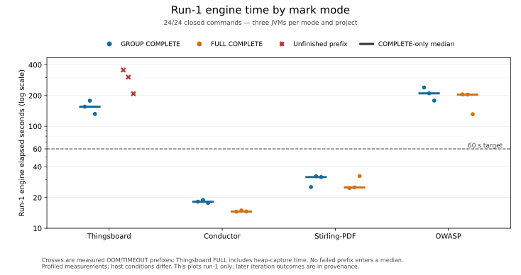

# Static summary erasure and run-1 mark modes

Campaign: 22–23 October 2026. Status: **measurements and representative heap analysis complete; acceptance limits below**.
Measured runtime: `b68b3a1c9389c8d1b8ab6ad513af0c586a546895`.
Fresh main: `f945f92c5ae554ff4f5fc7696ee5a269210478bb`.
A later documentation commit is not a new measured runtime.

All 24 candidate commands are closed: 18 end with OOM and six with TIMEOUT.
Conductor and Stirling-PDF meet the 60-second run-1 engine target in both
modes. Thingsboard and OWASP do not. No candidate finishes the whole analysis.
This report does not establish final performance, precision or no-FN acceptance.

The [evidence appendix](bidirectional-static-summary-erasure-performance-evidence-20261022.md)
keeps every raw command, phase, counter, profile and heap table.
The [selected spec](../../spec/run1-static-summary-erasure.md) and
[implementation validation](bidirectional-static-summary-erasure-validation-20261022.md)
describe the implemented scope. The future proposals below are not implemented.

## Measurement scope

The patch removes run-1 static-to-static summary storage and caller relay.
It keeps producer effects and adds actual-input static query completion for
run-2. One binary selects GROUP or FULL for run-1. Every later run uses FULL.
GROUP projects condition marks to their rule group. A selected-mark cleaner
requests demand but cannot remove that group. FULL keeps full-mark conditions
and exact selected-mark cleaning. RemoveAllMarks keeps its existing kill rule.
These mode differences can change the amount of admitted work.

Each project has three serial pairs, in GROUP/FULL, FULL/GROUP, GROUP/FULL
order. Java 17, aliases, statics, counters, JFR and GC recording are enabled.
Thingsboard uses 12 GiB; the other projects use 8 GiB. IFDS limits are 1080 s,
except OWASP at 1000 s. The 60-second target measures run-1 engine time only.

Evidence root: `/drive-testcomp/opentaint-go-rules/run1-static-summary-erasure-20261022`.
`preparation/paired-terminal.json` binds all 24 summaries and confirms
unchanged runtime source and configured inputs. Its SHA-256 is
`7f15220c462e9910f195f86959dae9a888c8631592be0f494f5650b5ae0dd20b`.
All timings are profiled. Host memory, swap and load differ between commands.
There is no fresh same-mode pre-patch timing control. Historical reports and
legacy main do not isolate a causal gain from this patch.

## Run-1 engine results

Medians and ranges below use COMPLETE run-1 engines. Failed prefixes are
separate. Their times include diagnostic heap capture and give no speed ratio.

| Project / mode | COMPLETE / attempts | Median (range), s | COMPLETE within 60 s |
| --- | ---: | --- | ---: |
| Thingsboard / GROUP | 3/3 | 155.560 (131.923–177.971) | 0/3 |
| Thingsboard / FULL | 0/3 | None; OOM prefixes 208.315–355.533 | 0/3 |
| Conductor / GROUP | 3/3 | 18.213 (17.677–18.929) | 3/3 |
| Conductor / FULL | 3/3 | 14.592 (14.549–14.942) | 3/3 |
| Stirling-PDF / GROUP | 3/3 | 31.766 (25.349–32.342) | 3/3 |
| Stirling-PDF / FULL | 3/3 | 25.131 (24.782–32.448) | 3/3 |
| OWASP / GROUP | 3/3 | 210.170 (178.420–239.889) | 0/3 |
| OWASP / FULL | 3/3 | 204.290 (131.253–205.207) | 0/3 |

The figure uses completed engines for medians. Thingsboard FULL has no
completed pair ratio. These are profiled measurements with different host
conditions; the figure does not establish a causal speedup.

Compare each completed pair before taking a summary. The ratios below are
FULL engine time divided by GROUP engine time in that same pair. They are
not ratios of the two per-mode medians.

| Project | Pair 1 | Pair 2 | Pair 3 | Median paired ratio |
| --- | ---: | ---: | ---: | ---: |
| Thingsboard | Unavailable | Unavailable | Unavailable | Unavailable |
| Conductor | 0.798821 | 0.789381 | 0.825483 | 0.798821 |
| Stirling-PDF | 0.977644 | 0.777028 | 1.021477 | 0.977644 |
| OWASP | 0.855423 | 0.972024 | 0.735643 | 0.855423 |

FULL uses less run-1 time in all three Conductor and OWASP pairs. The
Stirling-PDF direction changes in pair 3. These observations do not control
for host effects or the different condition and cleaner policies.

Keep GROUP as the default for the next iteration. FULL reduces observed
allocation on the completed project pairs, but it cannot complete
Thingsboard run-1 within the configured heap. Keep FULL as an experiment
option. This decision preserves run-1 coverage; it does not imply that
GROUP always uses fewer resources.

| Commands | Latest reached | Latest COMPLETE | Latest accepted forward |
| --- | --- | --- | --- |
| Thingsboard GROUP, pairs 1–3 | run-2 OOM | run-1 | run-1 |
| Thingsboard FULL, pairs 1–3 | run-1 OOM | None | None |
| Conductor, both modes, pairs 1–3 | run-2 OOM | run-1 | run-1 |
| Stirling-PDF, both modes, pairs 1–3 | run-2 OOM | run-1 | run-1 |
| OWASP GROUP, pair 1 | run-4 TIMEOUT | run-3 | run-3 |
| OWASP GROUP pair 2; FULL pairs 1–2 | run-6 TIMEOUT | run-5 | run-5 |
| OWASP, both modes, pair 3 | run-8 TIMEOUT | run-7 | run-7 |

## Fresh main and strict finding comparison

All four fresh main commands finish successfully. Main uses the legacy
engine and has no numbered run. Its legacy full-scan time is not run-1 time.

| Main project | Prescan s | Legacy full scan s | Whole command s | Results | Results with a concrete trace |
| --- | ---: | ---: | ---: | ---: | ---: |
| Thingsboard | 165.099 | 35.199 | 245.367 | 14 | 4 |
| Conductor | 31.832 | 26.450 | 109.197 | 7 | 5 |
| Stirling-PDF | 15.020 | 5.454 | 52.095 | 17 | 16 |
| OWASP | 38.341 | 51.863 | 137.216 | 4,112 | 3,619 |

Strict keys keep the full rule ID, path, full source span, method signature,
IR index and instruction. Occurrence counts keep duplicates. Values below
are per command; all three repetitions have the same complete primary and
strict occurrence multisets within each mode.

| Project / mode | Main strict keys | Exported strict keys / occurrences | Missing main keys | New strict keys / extra occurrences |
| --- | ---: | ---: | --- | ---: |
| Thingsboard / GROUP | 14 | 4,043 / 246,062 | 0 | 4,029 / 246,048 |
| Thingsboard / FULL | 14 | 0 / 0 | 14, censored | 0 / 0 |
| Conductor / GROUP | 7 | 1,260 / 8,171 | 0 | 1,253 / 8,164 |
| Conductor / FULL | 7 | 41 / 42 | 0 | 34 / 35 |
| Stirling-PDF / GROUP | 17 | 1,595 / 60,737 | **2, noncensored** | 1,580 / 60,722 |
| Stirling-PDF / FULL | 17 | 148 / 973 | **2, noncensored** | 133 / 958 |
| OWASP / GROUP | 4,112 | 4,112 / 9,179 | 0 | 0 / 5,067 |
| OWASP / FULL | 4,112 | 4,112 / 9,179 | 0 | 0 / 5,067 |

“Extra occurrences” subtracts the retained baseline occurrences. It does
not hide missing keys. Thingsboard FULL has no accepted report: its absent
keys are censored analysis failures, not established semantic false negatives.

The two Stirling-PDF baseline returns stay **MISSING** in every accepted
run-1 report. Later run-2 OOM does not censor these observations.

| Method | Missing main return | Candidate normal-exit location |
| --- | --- | --- |
| ConvertEmlToPDF.convertEmlToPdf(EmlToPdfRequest) | IR 103, lines 133–134 | IR 126, lines 148–149 |
| PipelineController.handleData(HandleDataRequest) | IR 50, lines 90–91 | IR 109, null return, line 130 |

Main's concrete traces identify the original return branches. Bidi Simple
output maps a generated exit to the last IR return when no trace location
is available. This source-backed coordinate difference does not prove that
the old branches or source flows are preserved. The exporter policy is
unchanged from the pre-patch runtime; the old frontier is not proved equal.

All six OWASP outputs have identical complete key/occurrence multisets,
although their accepted reports are run-3, run-5 or run-7. The 5,067 extra
occurrences are at existing locations. Bidi keeps complete sink-rule values
as separate keys; legacy storage merges them under `(ruleId, statement)`.
Simple output does not identify each internal rule variant. GROUP also has
large provisional exit-rule cohorts in the other projects. The appendix
records their source examples and export gaps. Lower FULL counts alone do
not establish a precision gain or a false negative.

All candidate exports are Simple; none is CONFIRMED. Matching sink keys
does not prove preservation of main's concrete source paths. The complete
closed comparison is `validation/finding-comparison/final-findings-table.json`
under the evidence root, with source-reviewed missing cases and hashes.

## First-pair profiles and representative heaps

The first-pair JFR analysis uses recorded engine boundaries and full
recorded stacks. Allocation sample weight estimates allocation work; it is
not retained heap. CPU contexts are inclusive and overlap.

| Project | Run-1 GROUP / FULL allocation weight, GB | Example run-1 Java CPU context |
| --- | ---: | --- |
| Thingsboard | 591.170 / 936.736, FULL OOM prefix | GROUP actual call-plan construction: 46.38% |
| Conductor | 79.435 / 52.907 | Actual call-plan construction: GROUP 42.14%, FULL 47.99% |
| Stirling-PDF | 83.581 / 68.181 | Actual aliases: GROUP 44.75%, FULL 55.48% |
| OWASP | 373.428 / 244.134 | Ordinary call processing: GROUP 80.82%, FULL 79.40% |

OWASP has only three run-1 static write regions and 75 FLOW writer rows.
Its profile therefore points to generic call, cleaner and AP work as well
as statics. It does not support a static-writer-only explanation. The
profiles show executed work, not a proof of an infinite loop or a twofold
removable-work bound.

The first Thingsboard FULL heap is **run-1 OOM**, with no accepted report.
Unit runners dominate 4.221 GB; the Spring provider subtree dominates
1.293 GB. A separate, overlapping StaticBatch union retains 521.8 MB with
2,841,377 pending supply records. Two batches each have only 13 complete
region patterns. The atom census proves at least 1,744,882 duplicate
memberships in those two batches. Merging them gives a **2.59x lower bound
on pending supply-record reduction in this snapshot**, not engine speedup.

The same heap proves at least 965,456 repeated successful form-slot builds.
That is a build-count lower bound, not a CPU share or a reason to retain
all payloads. The Spring wrapper also bypasses the early end-action-free
rule view. The completed census finds 102.7 MB in all allocated end lists,
mostly empty wrappers; the nonempty-list retained union is only 480 bytes.
This is about 0.9% of live heap. Required conditions and rule objects remain.
The Spring view fix is therefore deferred as a small measured scope.

The first Thingsboard GROUP heap is **run-2 OOM**, with run-1 accepted.
Unit runners dominate 3.327 GB. Separate owner unions retain 2.006 GB in
method execution and 1.603 GB in summaries/subscriptions; they overlap.
Its 656,415 LinkIn objects have an exact retained union of only 36.2 MB,
0.317% of live heap. Large event counts alone do not establish a dominant
retained-payload problem. The active run-1 static owners are absent here.
A run-2 heap cannot supply the earlier GROUP run-1 retained peak.

Pre-capture 30-second windows contain 27.286 s of GC pauses in FULL run-1
and 20.733 s in GROUP run-2. These stalls precede the diagnostic heap dump.
IR storage remains outside the optimization scope. Overlapping owner
unions must not be added to root-dominator partitions.

These snapshots are also **run-2 FULL OOM**, after run-1 accepted.
The configured mode below refers to run-1. Separate owner unions overlap.

| Project / run-1 mode | Live heap GB | Execution union GB | Summary/subscription union GB | LinkIn union MB |
| --- | ---: | ---: | ---: | ---: |
| Conductor / GROUP | 7.612 | 1.601 | 1.020 | 0.261 |
| Conductor / FULL | Unknown: root table capped | 1.512 | 1.120 | 0.0067 |
| Stirling-PDF / GROUP | 7.592 | 2.763 | 1.365 | 0.112 |
| Stirling-PDF / FULL | Unknown: root table capped | 3.921 | 1.146 | 0.0011 |

Conductor GROUP also has 2.243 GB under the RAM IR storage root, outside
the optimization scope. Its analyzer state contains millions of
statement/premise conclusion groups. Counts and bytes do not establish
that these relations are redundant. All six representative heaps are now
analyzed. Their different stopping points prevent a matched-progress
retained-memory comparison. All five run-2 snapshots lack active run-1
static service/point owners.

## Validation gates and next iteration

The focused Lean build passes 54 jobs. Common dataflow passes 1,771 tests;
JVM dataflow passes 438. Application tests have 172 passes, nine cleaner
failures and one skip. The 41 rule/join controls have 39 passes and two
exit-scope failures.
Fresh exact-base controls reproduce all **11 failed precision gates** with
the same normalized observations. Control `d2ad8e335` has the same core
bytes as pre-patch `30c1b8460`. They remain failures. This is not
project parity or a new precision acceptance.

The [next-iteration proposal](../design/bidirectional-static-summary-erasure-next-iteration-20261022.md)
targets removal of whole repeated work. None of these changes is implemented.
The first two run-1 proposals are recommended. The other run-1 candidates
need evidence or have a small measured scope.

| Priority / phase | Proposed change | Expected work removed and limit |
| --- | --- | --- |
| 1 / run-1 | Merge temporary static supplies before retention | Duplicate producer records; 2.59x snapshot bound applies only to pending supply records |
| 2 / run-1 GROUP | Skip no-op selected cleaning and repeated normalization | Walks with no semantic effect; preserve requests and prove producer closure first |
| Investigate / run-1 | Merge pending callee inputs before delivery | Run-1 pending-key multiplicity is unmeasured; measured run-2 LinkIn unions are small |
| Defer / run-1 | Select the end-action-free view through Spring before binding | Global end-list retained union is 102.7 MB; nonempty portion only 480 bytes |
| Separate / run-2 | Backfill only the newly permitted backward query | Repeated raw-summary scans; cannot improve run-1 |

No IR redesign, reference-manager rewrite, new exit restriction or
field-transfer change is part of these performance results. The appendix
keeps all raw tables, source-bound profile receipts, heap-query limits,
failed-query disclosures and the full finding classifications.
