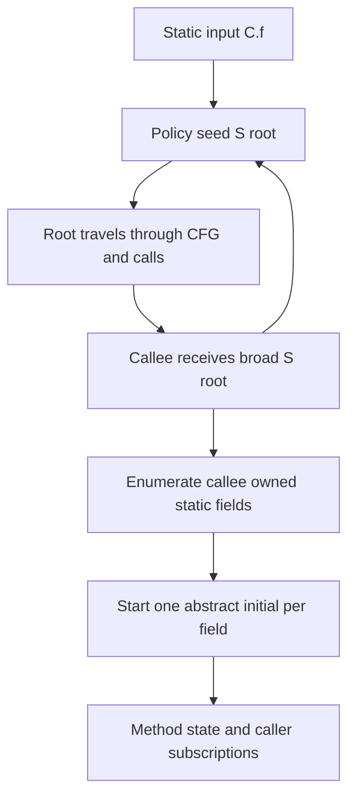

# ThingsBoard run-1: static workload and repeated work

Date: 16 October 2026. Status: heap census and independent review complete.
Analyzer implementation is unchanged.

The follow-up [unified run-1 request/write/static proposal](../design/bidirectional-request-gated-static-handling-20261016.md)
uses value-read field requests and a separate concrete-mark gate. The new
[field-write contract](../../spec/run1-field-writes.md) preserves ordinary
complete kills and disjoint keeps. Only a surviving E-requiring residual
demotes, keeping field E Empty.
It publishes ordinary NORMAL/DEMAND static identity summaries without S-root
initial propagation. Normal call application and handoff use those rows.
Demotion changes only the layer and keeps the known AP/tail. ContainsMark
contributes mark interest only. The selected
[static specification](../../spec/static-handling.md) also makes all F1
publications guidance-only and uses actual strong queries on run-2/later.
It replaces the earlier control-root/frame candidates below.
It is unimplemented; the measurements describe the current runtime.

Latest reached: **run-1, forward, limit 1; OOM**. No engine completes and no
forward report is accepted. The logged failed engine duration is 109.891609201
seconds; it is not a completed run-1 time or pure solver CPU time.

The measured runtime is `4acde739b`, captured at `05cf9ad62`. Current HEAD
`26ea71480` has the same core tree. Use the
[closed project measurements](bidirectional-static-domain-frozen-requests-performance-20261016.md).
The existing evidence root, called B below, is:

```text
/drive-testcomp/opentaint-go-rules/bidi-o1-o3-20261012/static-domain-frozen-requests/20261016T063718.860848Z
```

This investigation reuses the final ThingsBoard run-1 heap, profiles and logs.
It does not run a different project configuration or change analyzer semantics.

The heap contains a partial run-1 state. An actor whose static footprint is
wide may not yet have received or processed all of its inputs. Do not multiply
the global field vocabulary by every such actor and call that the measured
workload.

## Question and measurement rules

Test whether handling statics causes most of the retained analysis state and
work. Distinguish three populations:

1. A **static origin** has an original initial with base S. Its current result
   can have a local, argument or return base after a static read.
2. A **current static fact** has base S. Its original input can be nonstatic
   after a value is written to a static field.
3. A **static control root** is the special abstract S-root initial. It is not
   a concrete tainted static root and must keep its normal-return role.

Counting only current S facts misses static-origin local work. Counting distinct
canonical initials does not measure their repeated memberships. Counting live
or queued entries does not measure processed CPU time. Retained owner unions
overlap and must not be added.

## Result: statics dominate the stored propagation relations

The hypothesis holds for the measured live propagation populations. Static
origins account for **99.76% of method premise rows** and **99.60% of occupied
statement buckets**. This does not establish their share of total retained
heap bytes or processed CPU time.

| Measured population | Static numerator | Complete denominator | Static share |
| --- | ---: | ---: | ---: |
| Actor initial memberships, including ZERO | 2,336,846 | 2,410,745 | 96.93% |
| Actor initial memberships, excluding ZERO | 2,336,846 | 2,341,923 | 99.78% |
| Method premise rows, excluding the separate Reach directory | 2,336,846 | 2,342,470 | 99.76% |
| Allocated statement-reference cells | 41,361,967 | 41,448,103 | 99.79% |
| Occupied statement buckets | 4,472,457 | 4,490,385 | 99.60% |
| Actual dense-row array shallow bytes | 206,513,808 | 206,959,448 | 99.78% |
| Caller-input groups, classified by original premise | 4,771,197 | 5,040,127 | 94.66% |
| Caller-input groups, excluding REACH | 4,771,197 | 4,781,400 | 99.79% |
| Positional-index nodes, classified by current base | 5,759,755 | 5,852,153 | 98.42% |
| Positional-index postings, classified by current base | 4,809,607 | 5,082,315 | 94.63% |

The scalar-static numerator is sufficient here: the census finds no AND
premise cohorts in these selected stores. There are 5,077 nonstatic scalar
method rows and 547 ZERO-origin data rows. The separate Reach directory has
68,822 ZERO-origin rows. Do not drop those rows from a denominator silently.

### The dominant initial is an abstract static field

| Initial shape cohort | Live actor memberships |
| --- | ---: |
| Static field, abstract mark: `(S, C.f, *, {}, *)` | 2,332,098 |
| Special static root: `(S, empty, *, {}, *)` | 2,857 |
| Static class point, concrete mark: `(S, C, $, {}, T)` | 1,891 |
| Nonstatic empty-path initial, abstract mark | 5,077 |
| ZERO | 68,822 |

Of the static memberships, 2,334,955 have an abstract mark and only 1,891
have a concrete mark: **99.92% are abstract**. The global vocabulary contains
3,900 abstract static-field initials, plus the special root. Those 3,900 field
shapes occur 2,332,098 times across actors: about 598 memberships per shape on
average. This is repeated symbolic analysis state, not 2.33 million distinct
static AP shapes or concrete marks.

The new census reads path lengths and mark classes. The precise STAR/EXACT
tails, empty initial exclusions and absence of `[any]` are source-correlated
with the existing complete canonical-initial table and the admitted run-1
domain. They are not enum-name or path-content decoding by the new census.

### Wide footprints concentrate the workload

| Actor cohort | Actors | Initial memberships | Share of all memberships |
| --- | ---: | ---: | ---: |
| `allStatic=true` | 17,233 | 2,350,552 | 97.50% |
| `allStatic=false` | 51,589 | 60,193 | 2.50% |
| Nonempty `allWideMarks` | 17,229 | 2,350,548 | 97.50% |
| Empty `allWideMarks` | 51,593 | 60,197 | 2.50% |

Only 25.04% of actors have an all-static footprint, but they hold 97.50% of
all initial memberships and 99.76% of static initial memberships. This is the
strongest measured concentration. Wide mark needs include cleaner marks and
whole-static mark interests; these counts do not isolate a single metadata
producer as the cause. The actor counts do not assign method-directory or
subscription retained bytes to each footprint cohort.

### Caller inputs are almost all symbolic static FLOW

| Original premise → current input | Caller-input groups |
| --- | ---: |
| Static → static FLOW | 4,768,506 |
| Static → static TAINT | 2,216 |
| Static → nonstatic FLOW | 475 |
| Nonstatic → nonstatic FLOW | 8,963 |
| Nonstatic → static FLOW | 316 |
| ZERO → nonstatic TAINT | 531 |
| ZERO → static TAINT | 393 |
| ZERO → REACH | 258,727 |

Only **3,140 of 5,040,127 groups are TAINT: 0.0623%**. Current static FLOW
has 4,768,822 groups. Of these, 4,763,408, or 99.89%, have no root leaf and
empty field and mark exclusions. Another 510 have a nonempty mark exclusion,
942 have a field exclusion without a root leaf, and 3,962 contain a root leaf.
A root leaf can coexist with other branches; it does not mean a pure root.
This census does not decode every packed tree or its layer. In particular,
these tags do not establish exact unchanged `C.f → C.f` identity.

Only 510 current static FLOW input groups have a nonempty mark exclusion.
Thus the wide workload is already present without many such input-header
variants. This does not count mark exclusions in method conclusions or assign
the wide metadata needs to their producers.

The special-root original premise has 5,616 current static FLOW groups and
163 nonstatic FLOW groups. This proves that the nonstatic cohort exists;
the source review below identifies a route that can create such data. The
groups do not identify their creation route and are not proved dead. This
small root-origin cohort is distinct from the millions of field-initial
memberships above.

### The storage cost is mainly the repeated relation and its index

The method arrays are only 10.83% occupied: 4,490,385 occupied statement
buckets in 41,448,103 cells. There are only 1.92 occupied buckets per premise
row on average in this partial run-1 heap. This does not measure processed
statements or final CFG coverage.

The unused reference-cell payload is 147,830,872 bytes at four bytes per
reference. All dense-row arrays together are 206,959,448 bytes, or 1.81% of
the whole reachable heap. Sparse rows may help, but cannot remove the measured
2.01 GB method-directory union. They also do not avoid starting each field
analysis, its conclusion buckets or its caller subscriptions.

The positional index has the following exact current-static distribution:

| Postings in one node | Static nodes |
| --- | ---: |
| Zero | 1,692,491 |
| One | 3,572,071 |
| Two or more | 495,193 |

Thus 5,264,562 static nodes, or 91.40%, have zero or one posting. The existing
linked-set and backing-map shells cost 72 bytes per node. For this static
cohort alone, those two shells occupy **379,048,464 gross shallow bytes**.
Across all bases, the exact small-node shell cost is 383,252,040 bytes. This
replaces the earlier conservative lower bound of 238,391,712 bytes with an
actual cardinality count. It is not a net replacement saving or the full index
cost. Do not assign the index's 1.62 GB retained union to statics by multiplying
it by the static node percentage.

## Existing owner and execution evidence

The existing heap has 11,464,640,976 reachable shallow bytes and 332,060,159
objects. Its standing analysis state is much larger than its pending queues.

| Existing selected owner union | Bytes |
| --- | ---: |
| Caller input/subscription state | 2,371,746,016 |
| Its positional index | 1,621,602,496 |
| Method-local fact directories | 2,006,855,232 |
| All conclusion buckets, including other stores | 1,897,154,816 |
| Normal call/entry/exit sink caches | 1,092,007,080 |
| Current form contexts and caches | 574,279,648 |
| Authoritative dynamic request additions | 74,291,776 |
| Temporary method request stores | 94,050,072 |
| Method worklists | 103,490,944 |
| Event queues and buffered channels | 43,725,384 |

The canonical initial vocabulary has 3,919 abstract-mark objects: 3,901 static,
17 arguments and one `this`. There are 17 concrete-mark objects: 16 static and
zero. This is not an actor-weighted count. The actor stores retain 2,410,745
initial memberships; the original heap review did not split those memberships
by base. The new census above supplies that split.

| Logged run-1 counter | Count | Scope |
| --- | ---: | --- |
| Structural static-field initial attempts | 5,288,900 | Before actor initial deduplication |
| All initial candidates | 10,009,744 | All bases and all producers |
| Newly admitted initials | 2,410,746 | Cumulative admissions, not live memberships |
| Duplicate initial candidates | 7,598,998 | All candidates minus new admissions |
| Inherited static-B row skips | 1,235,917 | Existing unchanged-slot request fast path |

The one-entry difference between cumulative new admissions and live heap
memberships is not a count of static duplicates. These counters also do not
identify which static field attempts were fresh.

There is a useful lower bound within the same logged statistics object:
fresh structural offers cannot exceed all new admissions. Therefore at least
`5,288,900 - 2,410,746 = 2,878,154` structural attempts, or **54.42%**, did
not create a new actor initial. This includes cancellation-incomplete boundary
attempts; it is not the exact completed static-duplicate ratio or a CPU-saving
estimate. It confirms large repeated setup before admission without assigning
all 7,598,998 duplicate candidates to statics.

## Current fact and storage pattern

An ordinary run-1 static field initial is `(S, C.f, *, {}, *)`. It has an
abstract tail and abstract mark. A request may additionally emit
`(S, C.f, $, {}, T)` or `(S, C.f, *, {}, T)`. No run-1 initial uses `[any]`.
The special control initial is `(S, empty, *, {}, *)`.

The original initial remains the premise throughout the method. For example:

```text
original initial: C.f.* (*)

before read:     C.f.* (*)
x = C.f:         x.*   (*)     // local result, still static origin C.f
C.g = x:         C.g.* (*)     // current static position differs from origin
```

Storage keeps several relations beyond this AP shape:

```text
method state:
    full method/context/entry
      -> original premise
        -> statement
          -> result base / layer / field exclusions / mark exclusions
            -> packed result tree

caller subscription:
    callee + caller/context + call + original caller premise + caller layer
      + current fact header
        -> cumulative packed input tree
        -> positional index postings
```

The same canonical C.f initial can therefore occur in many actors, at many
statements and calls. Existing packing joins leaves and concrete output marks
within an exact group. It does not merge different original premises or caller
references. A flat union would lose input-to-output correlation.

A current static FLOW group does not by itself prove unchanged identity. Its
tree can contain several branches, and its field or mark exclusions can differ
from the original input. Count that narrower identity relation before assigning
a removable fraction to an implicit-identity design.

## The intended request bound does not bound abstract field work

The intended model assumes few requested static fields and few static-field
propagations. The current protocol has two different controls:

| Question | Current control |
| --- | --- |
| Which field needs symbolic analysis? | Structural selection from the supplied input and transitive footprint H |
| Which concrete marks must be analyzed for that field? | Effective mark requests R, plus an actual supplier carrying each mark |

`Run1Abstraction.emit` emits selected abstract field initials before reading R.
This preserves the required additive `*` initial for a needed field. F78 §1.3
and §2 explicitly require it. The problem is how a field becomes selected:
a special root counts as broad data supply, and nonempty root-wide mark needs
make H own every field. The same expansion then offers mark requests for all
selected fields through `wideRequests`.

```text
code contains a selected-mark cleaner on C.f/T
  -> T enters the profile's root-wide mark needs
  -> H.allStatic = true

special S-root FLOW reaches a callee
  -> selectedFields = every field in the global universe
  -> emit every selected C.field.* (*) initial
  -> offer T for every selected field
```

For fields in the frozen selected set S, B already contains the common mark
need. Outside S, the wide offer can add a dynamic request. This is broader
than requiring only a field explicitly used by that method. The current F75
selected-mark FLOW cleaner is itself same-base/global in its mark effect;
narrowing this behavior requires a proof, not merely a smaller container.

Call transport has another missing boundary. Each static fact that reaches
the CALLEES stage is subscribed and linked to every actual target, without a
per-field H or request test. The exact caller input is stored and indexed
before the callee's abstraction selects initials. The base-level touched test
always includes S. An unneeded field can therefore consume transport/storage
even when it does not start a callee field analysis. Skipping such transport
requires preserving its caller frame after an actual normal return.

Do not fix this by requiring nonempty R before every abstract field start:

```text
A receives an actual C.f/T supplier
A: C.g = C.f; call B
B: check ContainsMark(C.g, T)
```

An actual C.f supplier may initially have no C.f/T request in A. Its abstract
execution discovers the C.f-to-C.g dependency, through which B's C.g/T need
requests T on the original C.f slot. Suppressing that execution because its
mark request is absent would prevent discovery of the request itself.

The selected proposal makes the field boundary explicit:

```text
matching non-control supplier + field request
    -> abstract C.f.* (*)
actual supplied T + static mark request for C.f/T
    -> concrete C.f answer for T
```

The field request is a separate mark-neutral geometric need. It is not a test
for nonempty R, nor the current H flag widened by root mark needs. Only static
value reads seed it; mark checks, aliases and write targets do not. In the
selected proposal, complete store kills stay kills and only E-requiring
residuals demote. Static facts use ordinary stored N/D identity summaries;
the abstraction emits no S-root initial. The measured source behavior below remains the explanation
of the old workload. The analyzer remains unchanged.

The existing frozen plan is already logically broad: 15,671,695 field rows and
188,923,219 mark memberships summed over 51,953 closed CommonMethods. These are
not runtime request events or separately allocated mark cells. Shared payloads
use 79,080 primitive cells, including wide/class metadata, and no initial B
notification wave is sent. Factoring storage preserves this broad logical
relation; it cannot restore a narrow propagation boundary by itself.

The failed run-1 runtime counters separately record 6,052,845 collection calls,
68,617,407 offered mark memberships, 5,983,491 fresh dynamic memberships and
170,553 outgoing request batches carrying 4,872,393 memberships. These are
different events and units, not additional copies to sum. They include all
bases and do not identify how many requests are static or outside S.

## Static root activation amplifies the basis

The following behavior is present in source:

1. `Run1Abstraction.emit` maps every static input to the special S-root policy
   initial, including an input that mentions only C.f.
2. Actor initial deduplication starts that root once for the full method key.
3. JVM call plans always include S in their touched and binding positions.
   Static control therefore travels through calls too.
4. A callee receives the broad root as a normal FLOW supplier. Its abstraction
   enumerates its selected static fields and starts their individual initials.
5. The resulting field analyses traverse CFG statements and calls, add caller
   subscriptions, and publish summaries. A further callee repeats the process.



This is an eager symbolic input basis. It is not a large set of independently
allocated concrete taint marks. The basis may be needed by the current summary
protocol. Its first activation cannot simply be removed without a replacement
that preserves required summaries and return control.

A field initial emitted by root activation becomes its own original C.f
premise. Later field-origin counts do not retain the root as an activation
cause. A small special-root-origin cohort therefore would not bound how much
field-basis work the root started.

The name control root does not mean that all internal facts under that origin
are control-only. A broad root input can match an ordinary callee C.f summary.
The reader projects it to C.f, applies that summary and binds a returned FLOW
into a caller local under the original S-root premise. The ordinary statement
gate for root reads does not apply to this summary operation. Such local facts
still execute statements, calls and rules. Later consumers reject a root-premise
publication without normal static-root return evidence, but this is not proof
that all preceding internal work is dead. Root-origin nonstatic results are a
separate cohort to measure before proposing any pruning.

There is also repeated setup before deduplication. Each static `emit` calls
`selectedFields(input)` for structural initials, then `wideRequests(input)`
calls it again. A broad root scans the finite static field universe each time.
Repeated root arrivals repeat this work even when all emitted initials already
exist in that actor.

## Why one selected-mark cleaner can widen static work

All static positions share base S. `FlowClean.run` handles a selected mark T by
adding T to the FLOW mark-exclusion header and requesting T. This branch does
not first test the cleaner path against the current tree. Concrete TAINT
cleaning uses the path and reach instead.

For example, a cleaner for C.f/T can cause an abstract FLOW carrying C.g to
exclude T and request its concrete form, even when f and g differ. Concrete
handling then recovers the spatial behavior. The current reference/request
contract requires this callback; it is not an unproposed correctness fix.
Here, take the original normal initial slot to be C.g: the request is attached
to that origin, not to the cleaner C.f. A changed current position still requests
its original slot. The special S-root is not a normal mark-request slot, and
its root control component skips cleaner evaluation.

Metadata reflects this conservative behavior. It collects selected static
cleaner marks in `cleanerMarks`; freezing puts those marks into root needs.
A nonempty root need makes the footprint `allStatic`. A broad root supplier can
then activate every field in the global universe, rather than only the fields
that the method explicitly reads or writes.

The existing actor/emitter join has 17,233 all-static borrowers and 51,589 other
borrowers. The new census confirms those actor totals and shows the 97.50%
initial-membership concentration above. It does not split subscription or
statement populations by that actor footprint.

Precomputed request rows cover the profile's selected field set S. Wide
activation can also select a field outside S when the footprint owns it. Such
a field needs a dynamic request offer. It is unsafe to remove all wide offers:

```text
selected S = {C.f}; global universe = {C.f, C.g}; root mark need = {T}

B(C.f) includes T
B(C.g) is empty
broad root activation must still offer C.g/T dynamically
```

For a selected field inside S, its common wide marks are already in B. Offering
those same marks through temporary storage is guaranteed to add no membership.

## CPU attribution and limits

The full failed run-1 JFR window has 14,801 Java CPU samples. Call-plan build
appears in 41.70%, actual alias computation in 30.24%, and persisted-alias
acquisition in 26.08%. These are inclusive, overlapping shares. They do not
identify the current fact or original premise.

Alias computation is lazy per method owner. A large first-computation cost
across many methods does not prove repeated computation on each fact or form.
Neither the canonical vocabulary nor static keep edges assign that CPU to
statics. The native normal window also overlaps 17.45 seconds of heap capture;
its collector-heavy totals cannot serve as a clean run-1 CPU split.

There is a source-level link to investigate. `RunMethodCallServices.process`
borrows the full call plan before checking Reach, touched positions or the
current fact. On a plan-cache miss, `JIRCallPlanBuilder.build` constructs all
bind-back and persisted-alias stages before the consumer inspects that fact.
When bind-back has a local receiver, argument or result target, the persisted
alias lookup can force the method's first alias computation even if the
triggering fact is only static-root FLOW and later guards reject alias use.
Reading `entry.aliasAnalysis` creates its owner; that getter alone does not
compute aliases. Disabled aliases, no local target, cached plans and other
rule/resolution paths change this behavior. This establishes a possible cost
path, not a measured static share of the 30.24% alias-computation samples.

Use `B/measurement-review/thingsboard-static-cpu-review-20261016T113825.496284Z/`
for exact counters, frame patterns, complete native-stack review and source
bindings. Static CPU and allocation majority remain unquantified.

The source paths, activation law, inside-S/outside-S distinction, cleaner
contract caveats and root-origin local-data path are bound in
`B/preparation/thingsboard-static-propagation-source-review-20261016/`.

## Recommended focus

Use the new [request-gated static-handling proposal](../design/bidirectional-request-gated-static-handling-20261016.md)
for the next design. Its main target is avoiding unnecessary field analyses
and statement facts, rather than compressing the resulting relation. Ordinary
call subscriptions and input delivery remain; fewer caller-input groups are
not established by a call-delivery filter.
It collects field requests only for value reads, gates concrete answers by
actual marks, and keeps complete field-store kills while demoting only
E-requiring residuals. Ordinary N/D static summaries use the normal call path.
Demotion retains the AP and its known tail. It needs no special static-root control, return watcher
or pending frame store. Mark predicates add only mark interests. Later
iterations compute strong S→S relations from actual queries, even without
an F1 summary. F1 publications are guidance only, not reusable transfer edges.

These are new abstraction rules, not a proven speedup. E-free partial covers
and early default summaries can add run-1 may alternatives; the proposal requires finding and handoff
checks. The remaining alternatives below are historical investigation notes,
not selected parts of the new proposal.

Compact index postings still have a gross 379 MB current shell cost in the
static zero/singleton cohort, but a smaller index retains the same analysis
workload. More concrete-mark packing does not address the main measured
population.

## Earlier candidate directions, superseded by the new proposal

These source-level alternatives preceded the selected root-free run-1 model.
They explain proof constraints of a more precise control/frame design; they
do not describe the selected ordinary-summary call path. No analyzer code changes.
The order below follows the size of the relation that each direction could
avoid, not a measured byte or time saving. The first two are alternative
static-data designs; their possible savings are not additive.

| Direction | Current behavior → candidate behavior | Scope and proof needed |
| --- | --- | --- |
| Separate root control from static data activation | A control root activates the callee's field basis and can consume field-data summaries → retain return control, activate field analyses from actual matching data inputs | A new abstraction contract and completeness proof must cover actual broad TAINT, real explicit FLOW, late arrivals, cycles, zero-source generation and local rule effects |
| Use implicit static identity plus sparse effects | Analyze every active static basis field through ordinary CFG/call handling → represent unchanged static state implicitly and evaluate relevant effects | Preserve original origins, contexts, call order, normal-return evidence, writes, sources, sinks, requests and class points; an ownership move alone does not remove this relation |
| Scope selected-mark FLOW effects spatially | A same-base cleaner excludes T globally and relies on concretization → leave disjoint static branches unchanged and refine only affected branches | Requires an updated AP/reference and request contract, including layer/summary/report refinement; exact/BELOW partial cases need more than a simple two-tree split |
| Share transfers across alternative static origins | Run separate copies of the same mark-neutral transfer → process a group while retaining each output's origin labels | Labels are alternatives, not an AND premise; prove projection equals scalar execution and retain E/mx/layer and rule correlations |
| Make full-root activation idempotent | Re-enumerate structural initials and fixed wide offers on each input → complete that fixed activation once per actor | Preserve supplier/domain validation, control seed, actual direct-class marks, all concrete answers and request sends; set the flag only after complete full-root FLOW activation |
| Defer unrelated local call-plan work | Build local bind-back alias stages before inspecting the incoming fact → build a deferred stage only when its consumer needs it | Preserve stage order, guards, alias-sensitive rules and call resolution; current static base alone does not show that all alias analysis can be skipped |
| Share selection and omit already-covered wide offers | Select fields twice; subtract common marks already in B → reuse one selection and retain only required outside-S activation | Preserve field/class scope and cancellation; keep outside-S dynamic offers |

The local activation changes remove repeated setup but retain the first symbolic
field analyses and all required caller subscriptions. The larger static designs
target those standing relations. A new global taint pool would mix callers and
write order and is not a valid replacement.

A disjoint-cleaner identity can preserve a normal FLOW where current exclusion
and concrete STAR handling produce a demand-layer result. Even retaining the
request callback does not prove equal intermediate facts, layers, summaries or
reports. Specify and prove the intended refinement before changing that path.

The control-only root direction is narrower than a complete new static
environment. It would retain the required special seed while avoiding eager
field activation caused only by that control signal. Both abstraction and
summary application must respect the distinction; changing only one leaves a
route for root-origin data to activate fields again. It must not discard an
actual broad TAINT supplier or treat source and sink effects as dead code.
This is a design hypothesis, not a proved replacement for the current protocol.

In particular, the current untouched-frame reader can turn a broad root into
class/field residual data outside the callee footprint. For H={C.f}, a normal
return can produce a class-C residual excluding f; a later read of C.g can then
produce local data under the root origin. A control-only design must handle
that original-root return channel too, instead of retaining its current data
projection. Real noncontrol frame inputs still require that projection.

The census cannot identify which supplier first created each field initial.
Static-origin counts are not a count of initials caused only by root control,
and they are not a removable-byte estimate. Before choosing a replacement,
measure these narrower relations:

1. Fresh field initials caused by root control, broad class supply, explicit
   field supply and concrete request answers, per actor.
2. Caller inputs that are exact unchanged field identity, versus changed
   paths, exclusions, layers, marks or local results. A current S/FLOW tag is
   insufficient for this test.
3. Processed steps and call-plan misses by original premise and current base.
   Heap membership counts cannot supply this CPU split.

These checks select between avoiding artificial field activation and making
real static identity implicit. They do not require IR storage changes.

## Census method and evidence

The final census is a single-pass public MAT snapshot reader. It reads actor
sets, method maps and arrays, caller-input entries and index nodes. It does
not load or execute analyzer classes, invoke AP methods, export millions of
rows, or estimate processed work from a heap. It verifies each directory's
actual posting total against its stored counter. The 5,852,153 total index
nodes and 1,696,338 child maps also match the earlier independent census.

The authoritative result is `CENSUS_COMPLETE`, full scope, with all three
phases complete and **33 of 33 acceptance checks passed**. It matches all
previous actor, membership, method-row, allocated-cell, array-byte, directory,
group and posting denominators. Classification has no unknown cohorts.
Independent review checks the partitions and derived ratios. The reader takes
365.058 seconds and 203,615,353 charged visits within its fixed tool caps.
This is heap-tool time, not analyzer run-1 time.
The independent review closes with 60 checks passed, including the weighted
shape interpretation, posting cardinalities, shell costs and structural-offer
lower bound.

The capture's stat/header/footer binding and parsed-data index file stats are
unchanged. The MAT diagnostic log sidecar can append separately. The first
nested-OQL canary was stopped for excessive progress output; the first API
canary failed bundle registration. Neither contributes counts. The successful
API packet fixes that bundle metadata, passes its bound owner canary, then
passes the full census with the same source and budgets. No analyzer rerun or
runtime edit is involved.

| Evidence | Location under B |
| --- | --- |
| Source, private tool bundle, fixed budgets and manifest | `heap-static-work-api-v4/` |
| Complete counts and 33-check gate | `heap-static-work-api-v4/results-full/final-factored/thingsboard/job-20261016T121635.284620Z-0c499a951c/` |
| Weighted census derivation and closure | `measurement-review/thingsboard-static-weighted-census-20261016T122416.750459Z/` |
| Independent 60-check census audit | `measurement-review/thingsboard-static-census-independent-20261016T123051.836194Z/` |
| CPU/counter review and conditional call-plan/alias path | `measurement-review/thingsboard-static-cpu-review-20261016T113825.496284Z/` |
| Static activation, root data and control-only candidate source review | `preparation/thingsboard-static-propagation-source-review-20261016/` |
| Complete canonical initial table and source interpretation | `measurement-review/final-factored-thingsboard-heap-peer-review-20261016T0940Z/source-followup/` |
| Superseded failed canaries, not measurement evidence | `heap-static-work-v2/`, `heap-static-work-api-v3/` |

The full `census.json` SHA-256 is
`93852862d2715139f618177eaad075ce9d48b28c3178ed00ae721feccdf0b3ce`.
The `census-validation.json` SHA-256 is
`4ffc12b850008f9df90051e5cceb9d36f0a070e86cfecb58a64c78f59d8abdfc`.
The weighted review receipt SHA-256 is
`30d5f6846bc352521d7e2b820eb4e785335e2811022077da2b25643d5ccf591e`.
The independent audit receipt SHA-256 is
`0f091345493b3f88fabf5c77ad47bf361f0744ad3acf70b8b62987ef95434bf8`.

IR storage is outside this investigation's optimization scope. Latest reached
remains **run-1, forward, limit 1, OOM**, with no completed engine or accepted
forward report. No optimization or speedup is claimed as implemented here.
